# Biomass mission for water dynamics under forest <!--{ as="img" mode="hero" src="https://www.esa.int/var/esa/storage/images/esa_multimedia/images/2023/02/biomass_satellite_over_forest/24725063-1-eng-GB/Biomass_satellite_over_forest_pillars.jpg" }-->
#### 

## Authors: Inga Lammers1, Emilian Tietze2 and Niels Dedring1 
**Affiliations:**
(1) Ruhr University Bochum (RUB)
(2) TU Wien

*This story is based on results from the Science Hub Challenges organised and hosted by ESA's ESRIN Science Hub in 11/2026. It was developed by a team from the RUB and TU Wien.*

## 

  
  

## Challenge
The challenge involves observing hydrological processes like inundation and moisture in dense canopy layers. While traditional optical and shorter-wavelength SAR methods often struggle with such thick vegetation, the Biomass mission introduces P-band radar technology, which is specifically optimized for deeper penetration through complex biomass structures.

## Objective
Our objective is to leverage the unique capabilities of the Biomass mission's P-band radar to accurately quantify subsurface water dynamics. To validate these findings, we cross-reference our data with Sentinel-1 observations, allowing us to assess the performance advantages of P-band radar in forest-covered environments.
##### Guiding questions
- **What scatters, and how?** Polarimetric decompositions split the radar return into physical scattering mechanisms. Water under trees is expected to strengthen double-bounce scattering (trunk → smooth water surface → sensor). Exposed mud or a dry floor gives more surface scattering and less double-bounce.
- **Where does something change?** Interferometric coherence between the 3-day repeat acquisitions shows where the scene stays stable and where it decorrelates. Areas with low coherence under forest are candidates for changing water conditions; an area with high coherence is the stable reference.
- **Is the change linked to water?** The scattering components inside these areas are tracked over the seven dates and compared with the tide at each acquisition time. Sentinel-1 (C-band) is used as a contrast to show what a shorter wavelength sees over the same forest.

## Earth observations <!--{ as="eox-map" mode="tour" position="left" }-->

### <!--{ zoom=9 center=[89.355626,21.989834] layers='[{"type":"Tile","properties":{"id":"s2cloudless"},"source":{"type":"WMTSCapabilities","url":"https://tiles.maps.eox.at/wmts/1.0.0/WMTSCapabilities.xml","layer":"s2cloudless-2025_3857"}}]' animationOptions='{"duration":500}' }-->
#### Harinagar, Bangladesh
The Sundarbans region presents a complex hydrological landscape. SAR data allows us to observe water levels even beneath the dense canopy.

## Data

<table>
  <thead>
    <tr>
      <th>Data name</th>
      <th>Variable name</th>
      <th>Description</th>
      <th>Region</th>
      <th>Time range</th>
      <th>Resolution</th>
    </tr>
  </thead>
  <tbody>
    <tr>
      <td>Biomass L1C</td>
      <td>backscatter</td>
      <td><a href="https://earth.esa.int/eogateway/missions/biomass/biomass-data" target="_blank">metadata description</a></td>
      <td>Bangladesh Bhagba</td>
      <td>every 3 days</td>
      <td>40 m2 per pixel</td>
    </tr>
    <tr>
      <td>BIOMASS L2A</td>
      <td>forest / non-forest mask</td>
      <td>Forest mask from the L2A <code>annotation</code> folder, used to keep forest pixels only</td>
      <td>Sundarbans, Bangladesh</td>
      <td>2026</td>
      <td>~50 m grid (0.0005°) after regridding</td>
    </tr>
    <tr>
      <td>Copernicus Marine global analysis &amp; forecast</td>
      <td><code>total_sea_level</code></td>
      <td>Hourly total sea level, nearest valid cell to 21.6456° N, 89.5396° E</td>
      <td>Sundarbans coast</td>
      <td>25 Jul – 12 Aug 2026</td>
      <td>hourly</td>
    </tr>
    <tr>
      <td>Sentinel-1 SLC bursts (Copernicus Data Space, openEO</td>
      <td>coherence (VV)</td>
      <td>C-band interferometric coherence for comparison with BIOMASS</td>
      <td>AOIs from 6.6</td>
      <td>BIOMASS window ± 12 days</td>
      <td>6 or 12-day pairs, regridded to 0.0005°</td>
    </tr>
  </tbody>
</table>

- **Source**: SAR Data: Biomass l1c, Biomass l2a, Sentinel 1
Copernicus marine sea level data
- **Temporal coverage**: Measurements are available every 3 days, from 07/25/2026 to 08/12/2026 resulting in 7 SAR measurements.
- **Spatial resolution**: The raw data has an inital resolution of 39m azimuth and 6m range. After applying the "multilooking method" a resolution of about 40m per pixel is achieved.
- **Area**: The inital datafile has a width of 1363 pixels
and a height of 3425 pixels.

## Methodology & Results

Our methodology consists of seven main steps, starting with the reconstruction of the polarimetric SAR data and ending with the development of a potential wetness indicator.

##### 1. Scattering Matrix Reconstruction

The amplitude and phase information from the Biomass Level 1C measurement files are combined to reconstruct the complex scattering matrix:

  <i>S</i>pq = |<i>S</i>pq| ej&phi;pq

This matrix contains the complex scattering coefficients for the four polarimetric channels (HH, HV, VH and VV), preserving both amplitude and phase information.

##### 2. Polarimetric Multilooking

To reduce speckle and better characterize distributed targets such as mangrove forests, spatial averaging is applied to neighbouring pixels.

Two polarimetric matrices are generated:

- **Covariance Matrix (C3):** Calculated using the lexicographic target vector.
- **Coherency Matrix (T3):** Calculated using the Pauli target vector.

These matrices provide complementary representations of the polarimetric information and form the basis for the subsequent decomposition techniques.

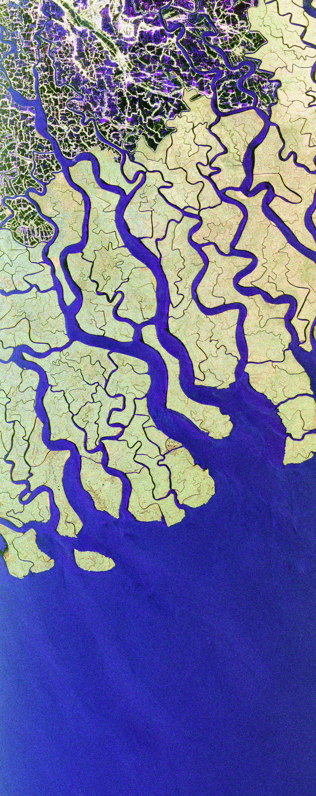

Figure 1: Pauli RGB showing distribution of power

##### 3. Polarimetric Visualization and Decomposition

 The Freeman-Durden method is applied to separate the signal into odd-bounce, double-bounce and volume scattering contributions. The Yamaguchi decomposition further refines this approach by adding a helix scattering component, which is essential for characterizing complex, non-symmetric forest structures where canopy orientation and geometric interaction create non-standard radar reflections.

This methods helps to distinguish the radar responses associated with vegetation, water and the underlying surface.
<figure style="text-align: center;">
  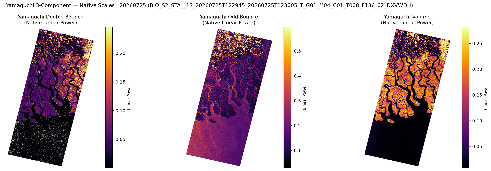
  <figcaption style="text-align: center;">Figure 2: Yamaguchi decomposition of the polarimetric signal.</figcaption>
</figure>

##### 4. Temporal Coherence Analysis

Temporal coherence is calculated for the seven SAR acquisitions (25 July–12 August 2026) using two approaches:

- **Consecutive comparison:** Each acquisition is compared with the following one to identify short-term changes.
- **Reference comparison:** All acquisitions are compared against the first timestamp to investigate changes relative to a common reference.

The resulting coherence maps reveal areas of different temporal stability.
<figure style="text-align: center;">
  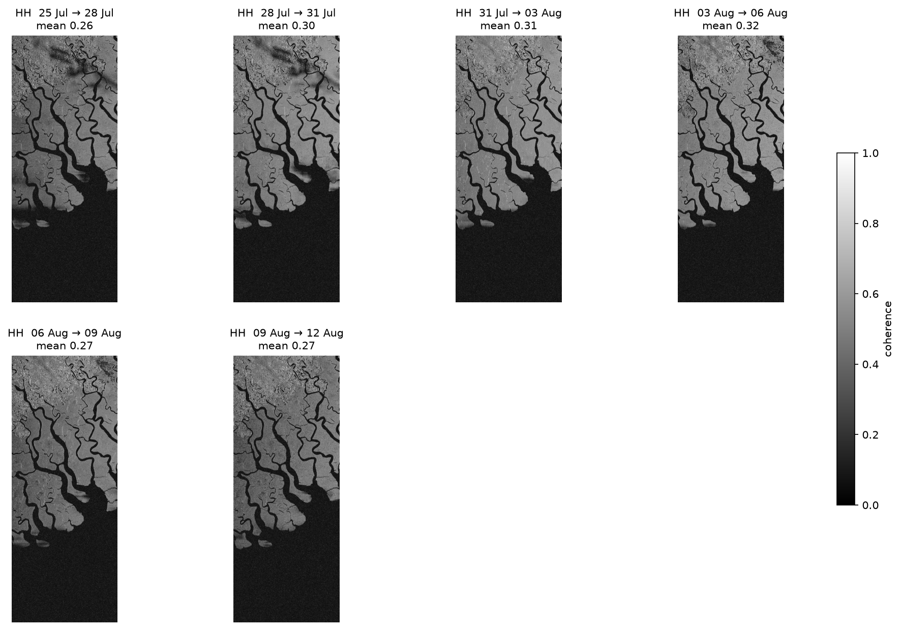
  <figcaption style="text-align: center;">Figure 3: Coherence maps / Consecutive comparison.</figcaption>
</figure>
<figure style="text-align: center;">
  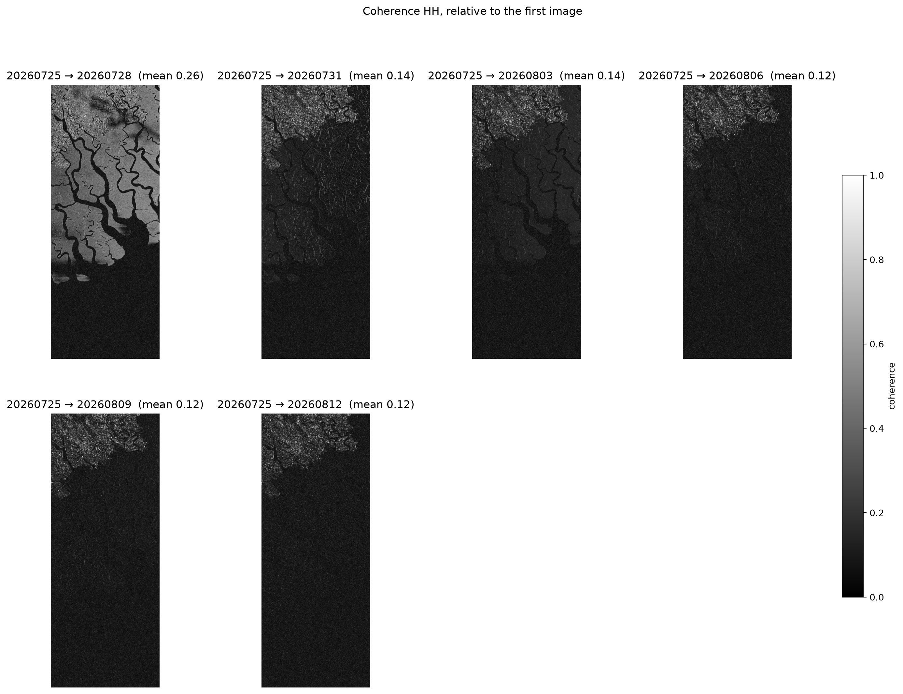
  <figcaption style="text-align: center;">Figure 4: Coherence maps / Reference comparison.</figcaption>
</figure>

##### 5. Selected Areas
Three approaches are considered to find specific areas of interest: 
<ul>
  <li><strong>First:</strong> Mean of all pairs relative to the first image (t0→t1, t0→t2, …).</li>
  <li><strong>Consecutive:</strong> Mean of all image-to-image pairs (t0→t1, t1→t2, …).</li>
  <li><strong>All:</strong> Mean of every pair from both groups.</li>
</ul>
 A square is slid over the mean coherence (forest only). The 3 squares with the lowest coherence and 1 with the highest (a stable reference) is picked, without overlapping. A square is only allowed if at least MIN_VALID of it is forest. Only the AOIs of the consecutive approach is saved as shapefiles and considered in the following steps.
 Within these chosen areas, the temporal evolution of the polarimetric scattering powers and decomposition parameters is analysed.

<figure style="text-align: center;">
  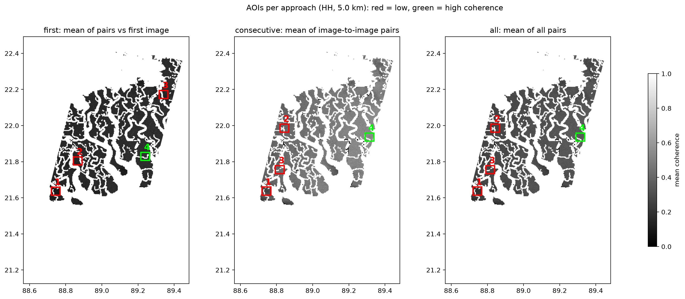
  <figcaption style="text-align: center;">Figure 5: AOIs selected based on different approaches.</figcaption>
</figure>
 A comparison with Sentinel 1 data is also created for the same timeframe consisting of 3 timestamps.
 
 
 
<figure style="text-align: center;">
  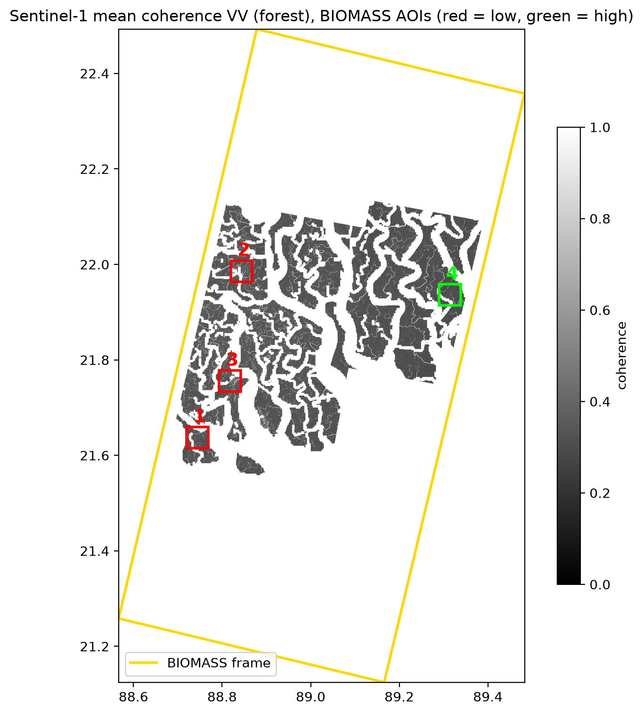
  <figcaption style="text-align: center;">Figure 6: Sentinel 1 coherence mean map over 3 time stamps.</figcaption>
</figure>

The objective is to identify which scattering contributions change most significantly throughout the observation period and how these changes relate to the underlying water conditions.

<figure style="text-align: center;">
  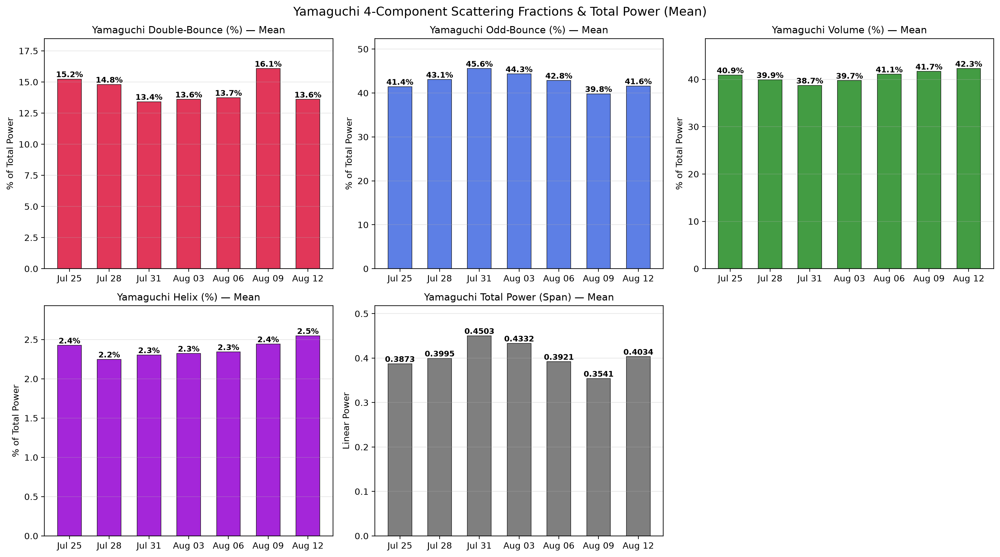
  <figcaption style="text-align: center;">Figure 7: Yamaguchi 4-component scattering fraction for AOI 3.</figcaption>
</figure>

##### 6. Temporal Pixel-wise Decomposition of Signal Power

To investigate tidal movement and its influence on radar backscatter, a pixel-wise decomposition of signal power was generated across the entire time series. This allows temporal changes in the individual scattering contributions to be tracked at each pixel, helping to identify areas where variations in water levels affect the radar response.

By examining the evolution of signal power over time, potential tidal-driven changes in scattering behaviour can be identified and compared with observed sea-level variations. This provides a basis for assessing the sensitivity of different scattering mechanisms to underlying water dynamics.

<figure style="text-align: center;">
  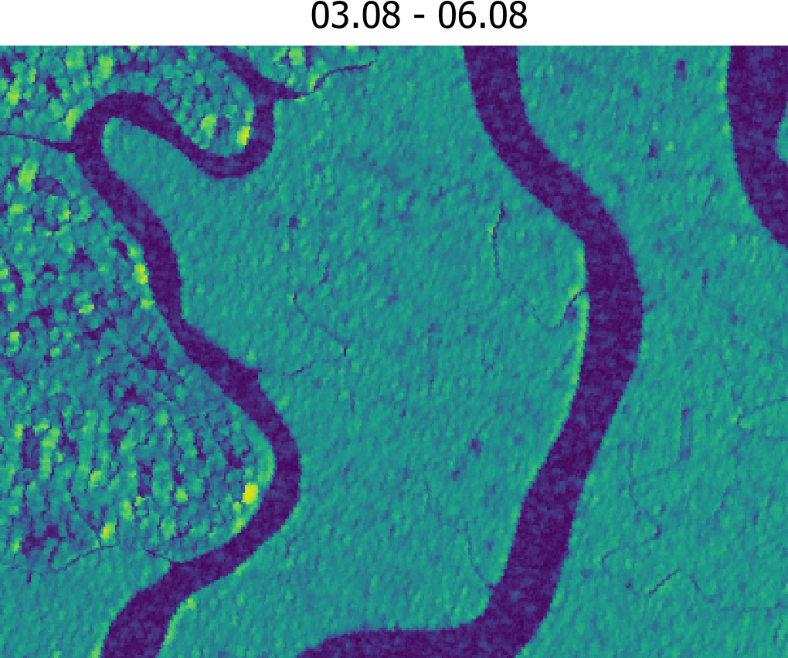
  <figcaption style="text-align: center;">Figure 8: Coherence map HH of selected area (AOI 1) over time.</figcaption>
</figure>
<figure style="text-align: center;">
  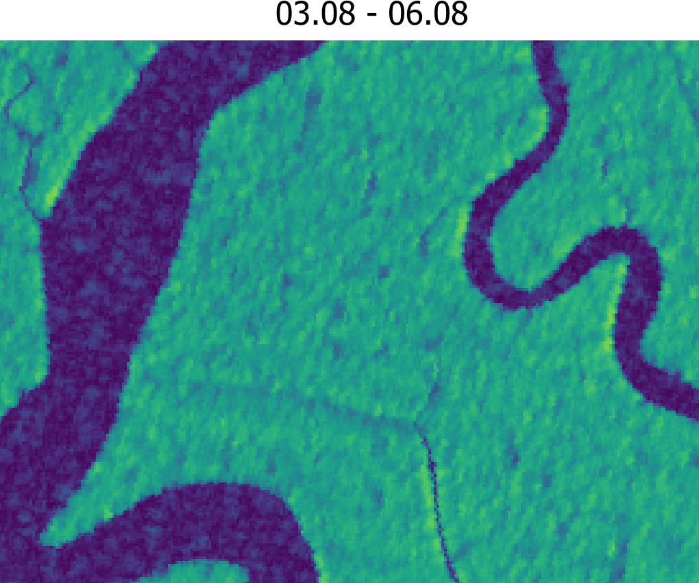
  <figcaption style="text-align: center;">Figure 9: Coherence map HH of selected area (AOI 2) over time.</figcaption>
</figure>
<figure style="text-align: center;">
  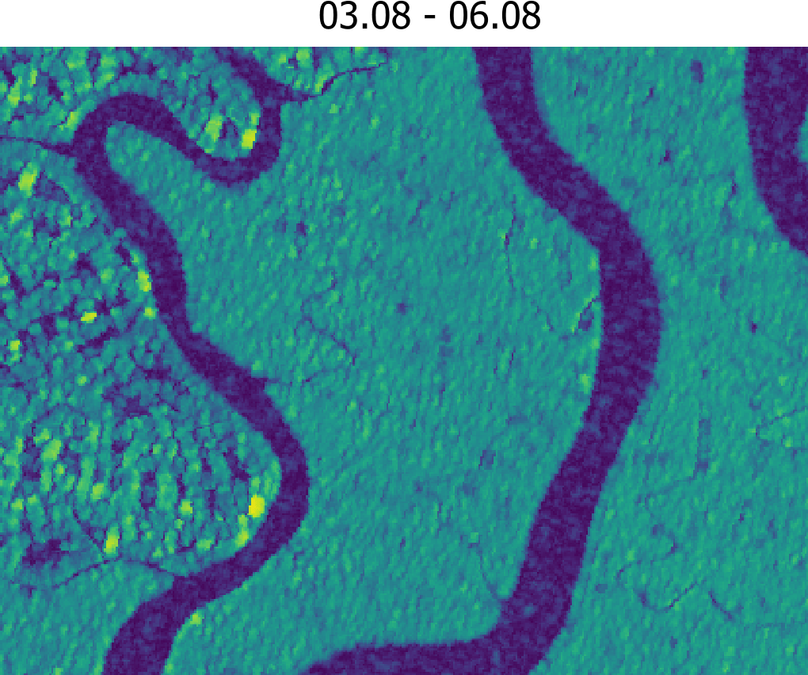
  <figcaption style="text-align: center;">Figure 10: Coherence map VV of selected area (AOI 1) over time.</figcaption>
</figure>
<figure style="text-align: center;">
  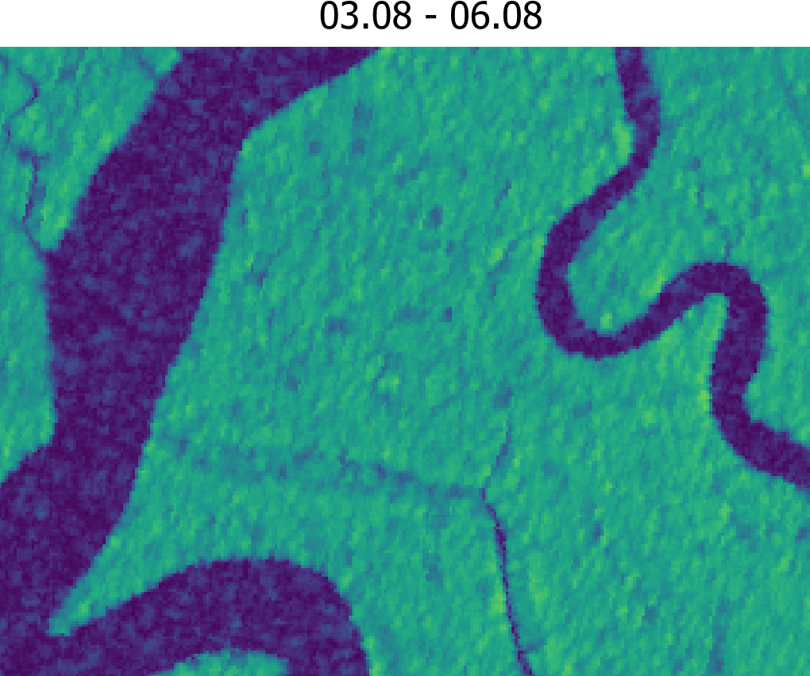
  <figcaption style="text-align: center;">Figure 11: Coherence map VV of selected area (AOI 2) over time.</figcaption>
</figure>
<figure style="text-align: center;">
  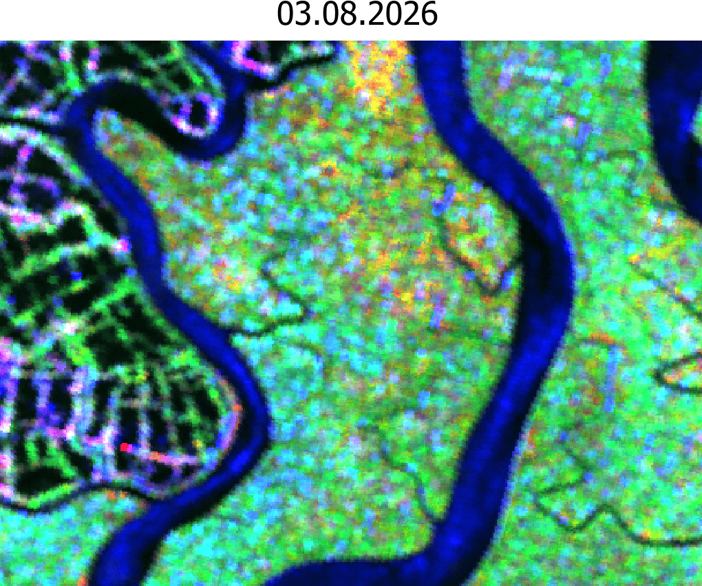
  <figcaption style="text-align: center;">Figure 12: Yamaguchi 4-component scattering fraction (AOI 1) over time series.</figcaption>
</figure>
<figure style="text-align: center;">
  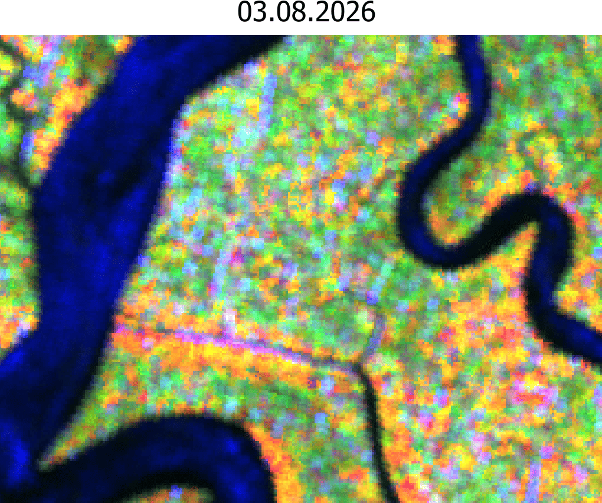
  <figcaption style="text-align: center;">Figure 13: Yamaguchi 4-component scattering fraction (AOI 2) over time series.</figcaption>
</figure>

##### 7. Copernicus Sea-Level Comparison and Wetness Indicator

Finally, the temporal changes in the SAR-derived parameters are compared with marine sea-level measurements from the Copernicus Marine Service.

By investigating the relationship between sea-level variations and changes in the polarimetric scattering contributions, we aim to identify the radar parameter most sensitive to changing water conditions.

Based on this relationship, we explore the development of an empirical **wetness indicator** to investigate the potential of P-band SAR for monitoring water dynamics beneath mangrove forests.

  <figure style="flex: 1; text-align: center;">
    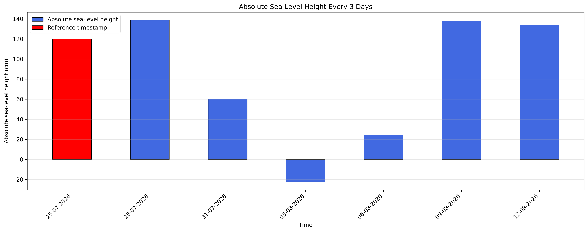
    
Figure 14: Sea level changes over the observation period.

  </figure>
  <figure style="flex: 1; text-align: center;">
    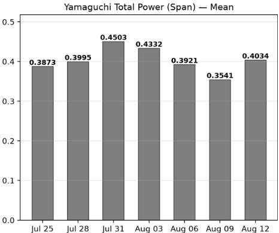
    
Figure 15: AOI 3 yamaguchi power.

  </figure>

## Limitations & Conclusions
<h3>Conclusion</h3>

  This study investigated the potential of ESA's Biomass P-band SAR data to observe water dynamics underneath a mangrove canopy in the Sundarbans near Harinagar, Bangladesh. Although no reliable wetness indicator could be identified, as no clear correlation was observed between sea-level variations and the Yamaguchi scattering components or total signal power, temporal changes in the radar signal were nevertheless detected.

  Variations in signal power and scattering contributions were observed both at individual pixel level and when analysing mean values across selected areas of interest. This demonstrates the potential of P-band SAR to capture temporal variability within dense mangrove environments and highlights its promise for investigating hydrological processes beneath forest canopies.

  However, further investigation is required to determine whether these observed changes can be directly attributed to tidal movement and to identify the scattering mechanisms most sensitive to changing water conditions. The results therefore represent a first step towards the development of a potential wetness indicator using P-band SAR data.

<h3>Limitations</h3>

  Several limitations must be considered when interpreting the results of this study.

<ul>
  <li>
    <strong>Limited temporal coverage:</strong> The analysis is based on only seven acquisitions between 25 July and 12 August 2026. This limited number of observations restricts the ability to capture the full tidal cycle, assess temporal variability in detail, and identify consistent patterns in the radar response.
  </li>
  <li>
    <strong>Sea-level data availability:</strong> Sea-level measurements from the Copernicus Marine Service were available for offshore locations rather than directly within the mangrove forest. Consequently, these measurements may not accurately represent local water levels beneath the canopy, where tidal propagation can be influenced by channels, vegetation, and local hydrological conditions.
  </li>
  <li>
    <strong>Temporal mismatch in sea-level measurements:</strong> The available sea-level data were averaged over time because measurements corresponding to the exact acquisition times of the Biomass observations were not available. This may have obscured short-term tidal variations and reduced the ability to establish a direct relationship between sea level and radar scattering.
  </li>
  <li>
    <strong>Lack of in-situ measurements:</strong> Apart from the sea-level data, no ground-based measurements, such as water depth, soil moisture, or inundation observations, were available for validation. Therefore, the observed temporal changes in radar signal could not be directly linked to measured water conditions beneath the mangrove canopy.
  </li>
  <li>
    <strong>Limited data maturity:</strong> The Biomass mission and its data products are still in their early stages. Further calibration, validation, and characterization of the data may improve the reliability and interpretation of polarimetric measurements in complex forest environments.
  </li>
  <li>
    <strong>Spatial resolution and mixed pixels:</strong> With a multilooked resolution of approximately 40 m, individual pixels may contain a mixture of vegetation, water, soil, and other surface features. This can complicate the interpretation of scattering contributions and mask smaller-scale hydrological variations.
  </li>
</ul>

  Overall, the results highlight the potential of Biomass P-band SAR for observing temporal changes in complex mangrove environments. However, longer time series, more precise sea-level data, and in-situ measurements will be necessary to better understand the relationship between radar scattering and water dynamics and to establish a reliable wetness indicator in the future.

## Contributors
Authors, contributors, and reviewers from [Ruhr University Bochum](https://services.ruhr-uni-bochum.de/en/rub-logo) and [TU Wien](https://fam.tuwien.ac.at/lehre/arbeiten/logos/Logos_TU/TU-Signet.jpg). (https://www.esa.int)

**Reference:**
ESA Science Hub Challenges (2026). Biomass mission for water dynamics under forest study.

**Image references:**
https://www.esa.int [Accessed: 18/11/2026]
https://services.ruhr-uni-bochum.de/en/rub-logo [Accessed: 18/11/2026]
https://fam.tuwien.ac.at/lehre/arbeiten/logos/Logos_TU/TU-Signet.jpg [Accessed: 18/11/2026]