# Recovering from drought? <!--{ as="img" mode="hero" src="https://www.amnesty.org/en/wp-content/uploads/2021/08/hunger-angola-1276x710.png" }-->
#### Authors: Maximilian Losbichler¹, Carina Villegas¹ and Hannah Kemper²  ¹Vienna University of Technology and ²Ruhr-University Bochum

## 

  

  

## Challenge
Droughts are slow-onset disasters that unfold live-threatening impacts on ecosystems and people's livelihoods. Such impacts range from crop loss and increase in food insecurity, but also result in the reduction of drinking water, displacement or power shortages. According to the World Bank between 600.000 and 900.000 people in Sub-Sahara Africa loose their job due to water scaricity every year. Rural employment drops by 7.4 percentage points when drought strikes, hitting women, older workers, landless farmers, and low-skilled laborers the hardest[1].
From 2018 to 2020 the Southern African drought hit the local population at a very vulnerable time: just when crops were planted. Decrease in rainfall resulted in decrease in soil moisture[2].

## 

  

**Fig. 1:** Satellite-derived soil moisture anomalies across Southern Africa in February 2019, highlighting significant dryness in key agricultural zones.

Given that drought conditions persisted over several months, both vegetation and soil moisture decreased substantially, resulting in crop failure across all Southern African countries. Widespread humanitarian assistance was requested to alleviate the acute food insecurity across the continent.

### Study Area
The Southern districts of Huíla, Namibe and Cunene of Angola were heavily affected by the 2018 drought resulting in 1.1 million people facing hunger and existential threat[3]. By 2021 malnutrition was widespread among the local population, resulting in illegal migration of thousand across the border to Namibia. In May 2021, the WFP estimated that 6 million people in Angola had insufficient food, with food insecurity most prevalent in the south of the country. It also noted that more than 15 million people are using crisis or emergency livelihood-based coping strategies, such as spending savings or reducing non-food expenses[4].

## 

  

**Fig. 2:** Drought-affected pasture lands put livestock herders at risk of food insecurity.

#### Landscapes of Angola
Angola's landscapes range from savanna, over grasslands to broadleave wood forests. Meanwhile the North of Angola has tropical moist climate, the Southern districts have more arid conditions.

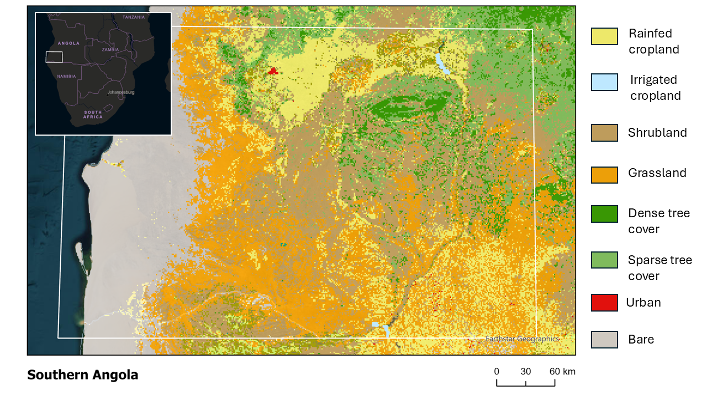

This case study focuses on the Southern part of Angola where cropland, grassland and forests are dominant landscape components.

##### Cropland
Angola's agricultural production focuses on cassava, maize, sweet potaoes and bananas [5]. The majority of the agricultural land is rainfed, with smallholder farmers reling on the seasonal cycles where rains usually last from October to May [6].

**Fig. 3:** Smallholder farming in Cunene province

A big percentage of the local population relies on the subsistence farming or livestock herding. During droughts Angolan farmers have reported a 40% loss in crops affecting their livelihoods and food security [7].
Only 4% of the farmland is currently irrigated, with the Minister of Agriculture stressing the importance of investment in irrigation schemes to assure production during dry spells [8].

##### Grassland and Rangelands

Grasslands are used traditionally for cattle and goat herding in South-Western Angola. Communities living of their cattle move according to water and grass availability between different geographic areas within Angola. This region has a semi-arid climate with a summer rainy season, though rainfall can be highly variable.

**Fig. 4:** Grassland dominated by wildlife and livestock herders.

The present flora is dominantly grasses but also shrubs and singular trees can be present. Wildlife is commonly present in from of elephants, kudus, rhinoceros, felines or zebras.

##### Forested areas

Though the Southern parts of Angola are not covered in dense tropical rainforest like the North, though there is substantial tree cover and woodlands are present. In Cunene province the dominant woodlands are composed of mopane trees with several grass species and big mammals being present in the area. Further North the slightly wetter miombo woodlands are composed of Brachystegia, Julbernardia, and Isoberlinia. There is substantial wildlife inlcuding hippopotamus, anitlopes, felines, rhinos and smaller mammals. Since most of the vegetation remains dry for several months, there is substantial risk for wildfires.

**Fig. 5:** Miombo Woodlands in Southern and Central Angola

## Objective
The objective of this study was to compare the recovery trajectory of the different land cover types and ecosystems after severe drought impacts in order to understand how this recovery unfolds and differs based on the present ecosystem.
Remote Sensing is a suitable method to study the observed drought impacts and the development of different ecosystem after the rainfall onset as it allows the processing over vast landscapes and in conditions where field data collection is challenging.

**Q1: How do different landcover types behave before, during and after a drought? Is there any difference visible during the recovery?**

**Q2: Which landcover type shows the biggest drought impact? Where was the drought impact located in Southern Angola?**

## Data and Methods
Explore the response and recovery of different landuse types during the 2018/20 drought in Southern Africa focusing on the Southern regions of Angola comparing the time-series of different indicators.

#### Dataset
- **Source**: ESA CCI Landcover, Irrigated Land (identified through very-high resolution imagery), ESDC Vegetation Indices, Extreme events dataset (Dheed) 
- **Temporal coverage**: 2000 to 2021

#### Methodology workflow

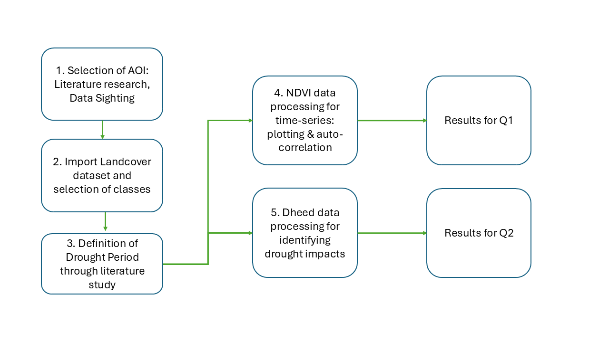

The workflow combined landcover datasets with visual inspection and literature research. The Data processing looked into NDVI time-series analysis and Dheed extreme data processing for identifying the location and gravity of drought impacts.

## Results
**Q1:** How do different landcover types behave before, during and after a drought? Is there any difference visible during the recovery?

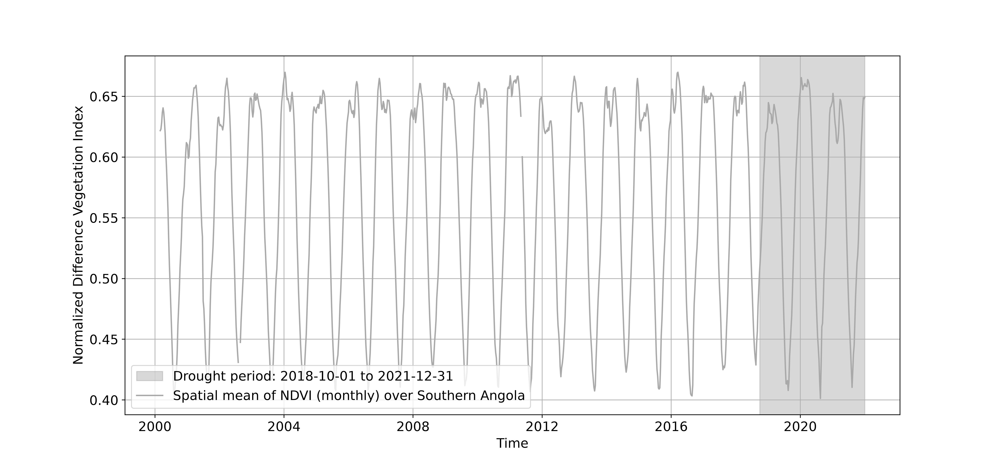
**Fig. 6:** General NDVI time-series without considering landcover types

Looking at generic NDVI mean values across the study areas, there are very little difference visible for the identified drought period. It is crucial to consider landcover types and ecosystems while studying drought impacts.
While splitting the NDVI mean values into different landcover types, more differences are visible.

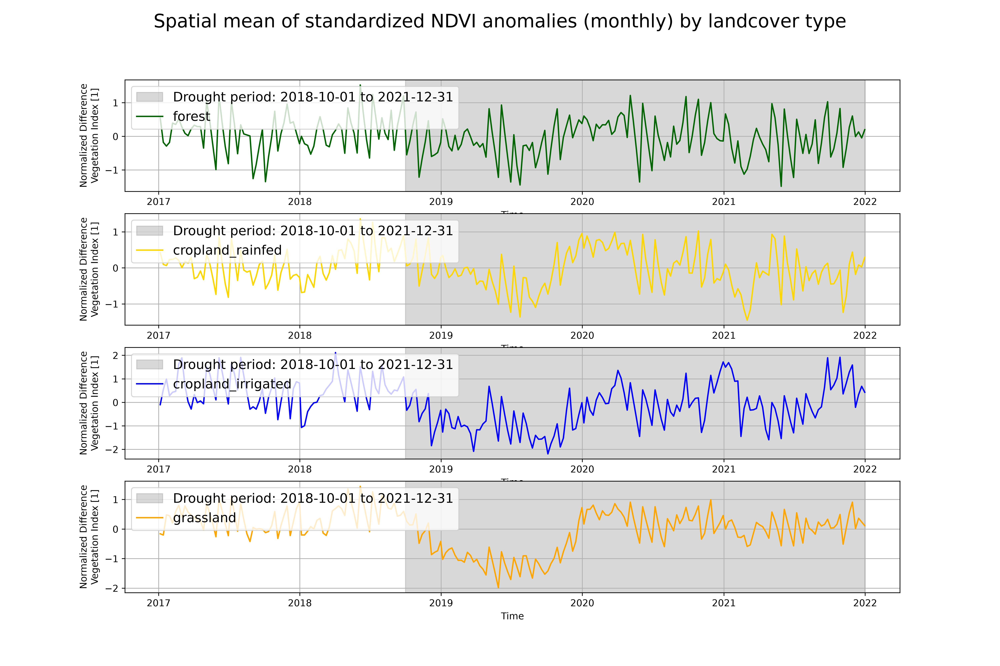
**Fig. 7:** NDVI time-series over different landcover

Forests:
- Forest anomalies fluctuate around zero throughout the record.
- During drought (2019 especially), several strong negative anomalies occur (down to -1.5).
- Recovery is relatively quick, with values frequently returning near normal or slightly positive levels during 2020-2021.

Rainfed cropland:
- Clear decline in anomalies during 2019.
- Prolonged negative phase between mid-2019 and early 2020.
- Lowest values reach approximately -1.4 to -1.5.
- Some recovery in 2020, but variability remains high through 2021.

Irrigated cropland:
- Largest overall variability of all land-cover types.
- Strong negative anomalies in 2019, some approaching -2.
- Strong positive anomalies later (up to +2).
- Noticeable recovery beginning in 2020 and particularly during parts of 2021.

Grassland:
- The strongest and most prolonged decline in NDVI during 2019.
- Rapid losses in vegetation greenness when water becomes limiting.
- A relatively rapid recovery once conditions improve.

This behaviour is typical of grass-dominated ecosystems because: Grasses have shallow root systems and depend heavily on recent rainfall. Productivity responds quickly to changes in water availability. Recovery can also be rapid since grasses have shorter growth cycles than forests or shrublands.

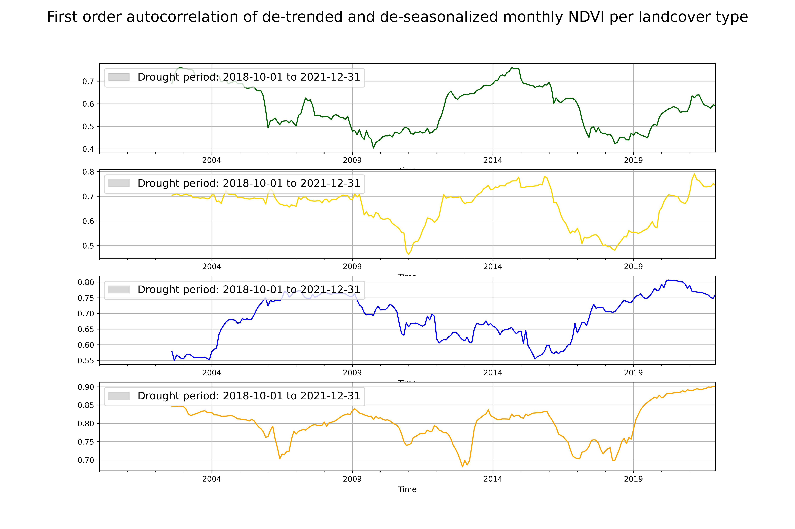
**Fig. 8:** First order autocorrelation and de-seasonalized NDVI per landcover type

This graph depicts the legacy of previous NDVI values for current values, where a higher auto-correlation results in slower vegetation changes and current conditions are heavily influenced by previous conditions. In drought studies, a rise in autocorrelation is often considered an early warning signal of ecosystem stress.
The shaded drought period generally coincides with:

- Elevated autocorrelation in several land-cover types.
- Particularly strong increases after 2019.
- Highest values observed toward 2020-2021.

This suggests that vegetation dynamics became increasingly persistent during the drought period, meaning that vegetation conditions were more strongly dependent on previous months and less capable of rapid recovery.

Although forests remained relatively productive in the anomaly graph, this autocorrelation analysis suggests that forests nonetheless became more sensitive to prolonged stress.
Both cropland classes showed an increase in auto-correlation suggesting that the irrigation practices did not shield sufficiently to avoid any long-term impacts.
Grasslands show the strongest increase in auto-correlation, demonstrating the higher vulnerability to drought periods affecting the NDVI values.

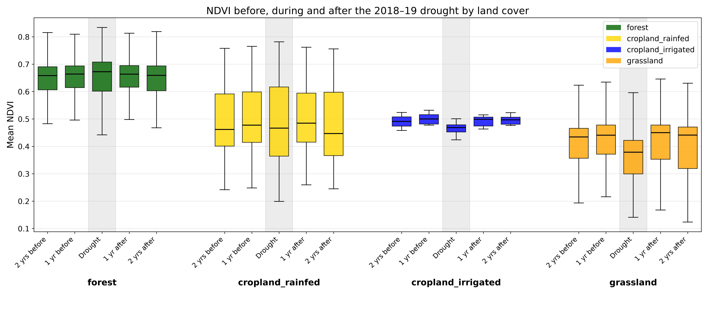

**Fig. 9:** NDVI distribution before, during and after the 2018/20 drought per landcover class. The NDVI distribution of the irrigated cropland shows much less variation compared to rainfed cropland.

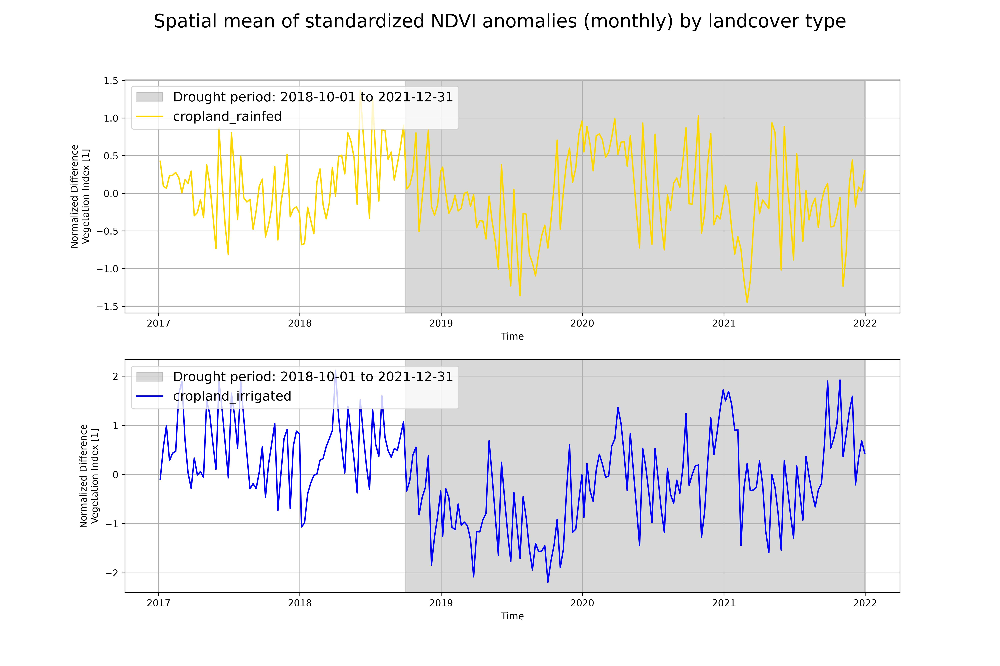
**Fig. 10:** NDVI distribution of rainfed and irrigated cropland during drought event.

**Q2:** Which landcover type shows the biggest drought impact? Where was the drought impact located in Southern Angola?

The Dheed dataset indicates areas which experienced drought stress according the PEI 1st percentile.

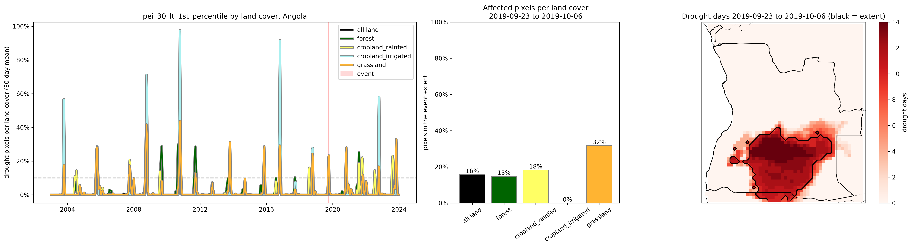
**Fig. 11:** Drought affected pixels per landcover category.

Grassland:
- Grasslands show the highest drought impact during this event.
- The orange curve reaches approximately 32% affected area, meaning almost one-third of grassland pixels experienced extreme moisture deficit.
- Grasslands frequently show large peaks through the record, indicating high sensitivity to drought variability.

Rainfed cropland:
- Rainfed cropland records about 18% affected area.
- This is above the overall land average and suggests substantial agricultural exposure.
- Since rainfed systems rely directly on precipitation, their response is expected to be strong.

Forest:
- Forests show about 15% affected area.
- Although affected, forests appear slightly less impacted than rainfed cropland and substantially less than grasslands.
- This suggests greater drought buffering capacity, likely due to deeper rooting systems.

Irrigated cropland:
- Irrigated cropland shows 0% affected pixels during this event.
- This strongly suggests that irrigation mitigated moisture stress sufficiently to prevent conditions from reaching the extreme drought threshold.
- Alternatively, the irrigated cropland area may be relatively small and located outside the drought core.

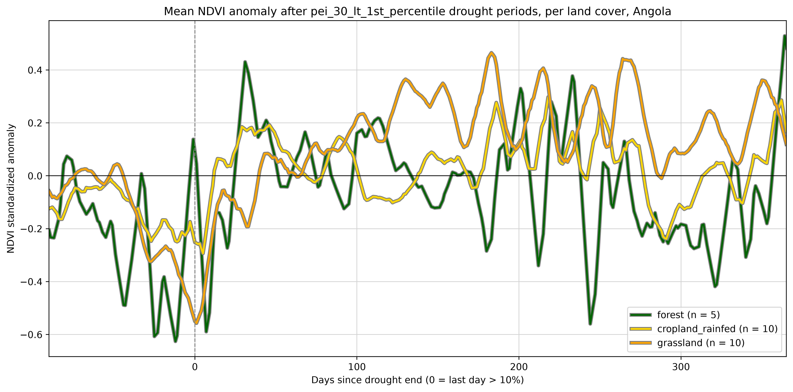
**Fig. 12:** Drought recovery trajectory after the end of drought.

- Grassland shows strong and sustained recovery with positive anomalies after 100 days
- Forests show heterogeneous results in the recovery, with positive and negative anomalies, which shows that there are further indicators to consider
- Cropland recovers quickly after drought but anomalies are closer to 0 compared to grassland. Crop types and planting are decisive.

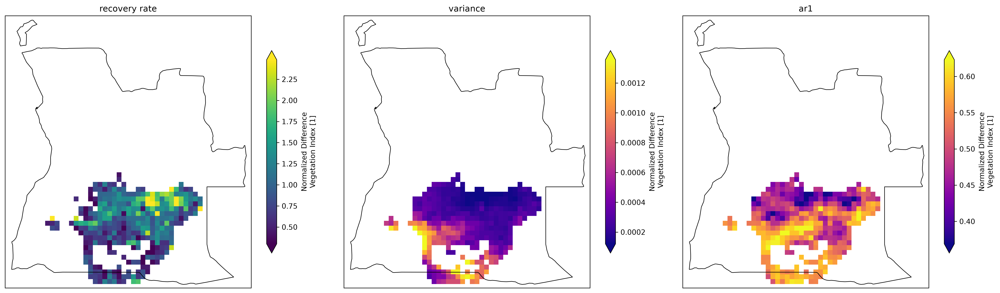
**Fig. 13:** Resilience maps.

The spatial distribution of the recovery rater and variance shows spatial patterns, that could be connected to landcover classes. The main constraint of this approach is the spatial resolution of the NDVI data used.

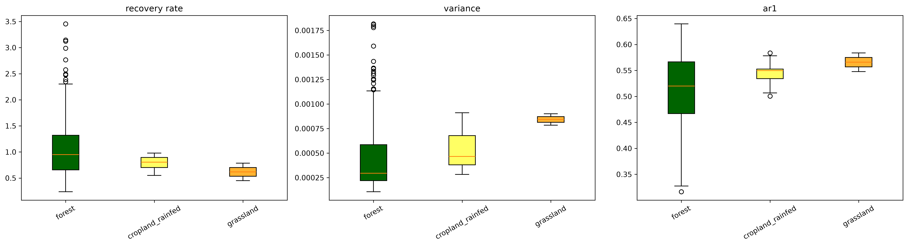

**Fig. 14:** Resilience matrix of landcover types.

Looking at the recovery rate (standard devidation getting back to -1 minus the lowest standard deviatoin in the month) forests show the highest variance in recovery, meaning that there is heterogeneous recovery time across the forest cover class. Rainfed cropland and grasslands shows more homogeneous recovery time.

## Conclusions

Drought is a spatially and timely complex phenomenon affecting vast areas and diverse ecosystems. The slow-onset nature of drought affects livelihoods and local population. The conducted study implies that grasslands are the most drought-sensitive land-cover type with up to 32% of all pixels affected by drought in 2019 and negative anomalies of -2 standard deviations. Although grasslands experienced the strongest drought-induced declines, they also showed the most pronounced post-drought greening. NDVI anomalies shifted from strongly negative values during drought to sustained positive anomalies for much of the year following drought termination. This indicates high sensitivity to rainfall deficits but also a strong capacity for recovery when water becomes available.

Forest have the highest median recovery rates but also show the greatest variability, indicating that the vegetation recovery could depend on the plant composition and other external factors.

Rainfed croplands repeatedly showed negative NDVI anomalies during drought and had 18% of pixels affected during the 2019 event. In contrast, irrigated croplands were largely unaffected during that event (0% affected pixels), demonstrating the buffering effect of irrigation against short-term moisture deficits. However, irrigated systems still showed increased autocorrelation during prolonged drought, suggesting that irrigation does not completely eliminate drought stress.

The lag-1 autocorrelation (AR1) analysis showed increasing persistence during the 2018-2021 drought period. Higher autocorrelation means vegetation conditions became more dependent on previous conditions and less able to recover quickly from disturbance. This pattern suggests a general decline in ecosystem resilience during prolonged drought.

## Open Science
#### Notebook
Access the notebook to reproduce the study workflow.
<iframe width="100%" height="600" src="LINK TO NOTEBOOK" frameborder="0"></iframe>
https://jupyterhub.deepesdl-v2.eox.at/hub/user-redirect/lab/tree/sciencehub-challenges-user-data/processing/team-2_vegetation_drought/ScienceHubChallengeNov2026_Notebook-Team-2-Vegetation_Drought.ipynb

#### References
[1] https://blogs.worldbank.org/en/africacan/building-drought-resilience-across-southern-africa-a-regional-imperative

[2] https://science.nasa.gov/earth/earth-observatory/drought-harms-corn-crops-in-southern-africa-144704/

[3] https://reliefweb.int/report/angola/over-one-million-angolans-affected-drought

[4] https://www.amnesty.org/en/latest/news/2021/07/angola-millions-facing-hunger-as-thousands-flee-their-homes-as-drought-ravages-the-south-of-angola-2/

[5] https://www.fao.org/faostat/en/#data/QCL

[6] https://www.trade.gov/market-intelligence/angola-agribusiness-cold-chain-industry

[7] https://actalliance.org/alerts/angola-drought-2/

[8] https://360angola.com/business/agri-business/irrigation-systems-cover-only-4-of-angolas-agricultural-fields/

#### Image and Visualization Credits
Fig. 1: https://assets.science.nasa.gov/dynamicimage/assets/science/esd/eo/images/imagerecords/144000/144704/southernafrica_fldas_201902.png?w=720&h=545&fit=clip

Fig. 2: https://www.forafrika.org/angola/drought-in-angola-dismantles-families/

Fig. 3: https://360angola.com/wp-content/uploads/2026/05/agricultura-angola.jpeg

Fig. 4: https://encrypted-tbn0.gstatic.com/images?q=tbn:ANd9GcTg8v3WmFWWIeIEB-AjGT_2NiYKSiuSzFPnWLLYsKKCqg&s=10

Fig. 5: https://encrypted-tbn0.gstatic.com/images?q=tbn:ANd9GcT4qCYNzBS7urOo1ZDv3xACGBXFO5zUSnyOV_2Oq9gOWA&s=10

All other Figures from authors.