# Raging Fires and Back to Baseline? Tracking vegetation resilience from space <!--{ as="img" mode="hero" src="https://climate.esa.int/media/images/Fire-CCI-banner_1920.min-1280x200.format-jpeg.jpg" }-->
## Authors: Jakob Everke ¹ , Kyzer Gerez ¹ , Jonas Siethoff ² <!--{ style="font-size:1.5rem;opacity:0.7;margin-top:1rem;" }-->
> ¹ TU Wien ² Ruhr University Bochum

*This story is based on results from the Science Hub Challenges organised and hosted by ESA's ESRIN Science Hub in **November 2026**. It was developed by a team from **TU Wien** and **Ruhr University Bochum**.*

##  <!--{ nav="false"}-->

  
  

## Challenge
Forests cover about **a third of the Earth's land surface** ([Forzieri et al., 2022](https://doi.org/10.1038/s41586-022-04959-9)), yet their importance reaches far beyond that footprint. They support **biodiversity**, store **carbon** and benefit **human health** ([Watson et al., 2018](https://doi.org/10.1038/s41559-018-0490-x)). As major **carbon sinks** that also regulate regional **temperature and hydrology**, they are central to **climate mitigation and adaptation** ([Reek et al., 2026](https://doi.org/10.1126/science.ads4361)).

Over long timescales, forests have adapted to specific **disturbance regimes**, defined by the type, severity and frequency of fire, and these regimes have shaped their **resilience** ([Johnstone et al., 2016](https://doi.org/10.1002/fee.1311)). **Climate change** is now making disturbances **more frequent and more severe**, which can fundamentally alter forest **structure and function** ([Seidl et al., 2016](https://doi.org/10.1111/1365-2664.12511)).

This raises a central question: **how well can forests absorb these shocks and return to their prior state?** The answer decides whether forests stay functional and stable in the long term. The capacity to **resist** disruption, **recover** structure and function, and **persist** under changing conditions is called ***resilience***, and it is the focus of this story.

## Objective
The objective of this study was to measure how vegetation responds to and recovers from wildfire across **Europe** between **2003 and 2022**. We asked four questions:

1. **Did the fire cause a significant drop in vegetation?**
2. **How severe were the fires?**
3. **Did the vegetation recover, and how long did it take?**
4. **Does recovery differ between land-cover types and across vegetation indicators?**

## Where did it burn?

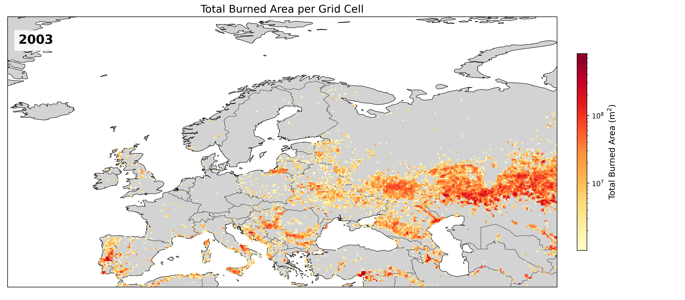

*Burned area per year across Europe, 2003–2022, from the ESA CCI Fire Burned Area product.*

Every year, most of the burned area lies in a **belt across eastern Europe**, from Ukraine through southern Russia to northern Kazakhstan, while the Iberian Peninsula, southern Italy and the Balkans burn repeatedly on a smaller scale.

  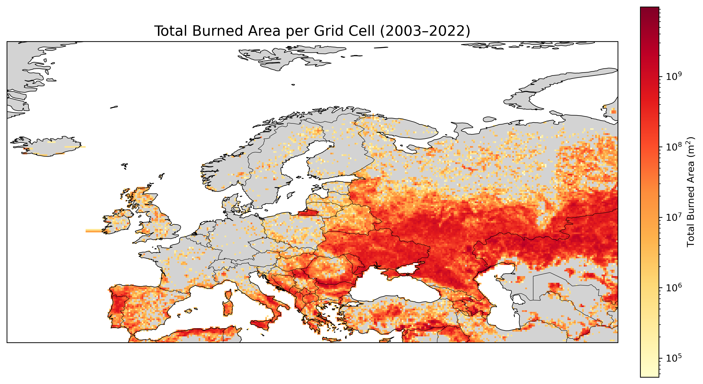

*Total burned area per 0.25° grid cell over the whole period 2003–2022.*

Over the whole period, the largest burned areas accumulate in the **eastern European steppe and forest-steppe** and on the **Iberian Peninsula**, whereas western, central and northern Europe burned only sporadically.

## Vegetation in motion <!--{ as="eox-map" mode="tour" }-->

### <!--{ layers='[{"type":"Tile","properties":{"id":"terrain-light;:;EPSG:3857","title":"Terrain Light","visible":true},"source":{"type":"XYZ","url":"https://{a-e}.s2maps-tiles.eu/wmts/1.0.0/terrain-light_3857/default/g/{z}/{y}/{x}.jpeg","projection":"EPSG:3857","attributions":"{ OSM: Data &copy; <a href=\"http://www.openstreetmap.org/copyright\" target=\"_blank\">OpenStreetMap</a> contributors and <a href=\"https://maps.eox.at/#data\" target=\"_blank\">others</a>, Rendering &copy; <a href=\"http://eox.at\" target=\"_blank\">EOX</a> }","tileGrid":{"tileSize":[256,256],"origin":[-20037508.342789244,20037508.342789244],"resolutions":[156543.03392804097,78271.51696402048,39135.75848201024,19567.87924100512,9783.93962050256,4891.96981025128,2445.98490512564,1222.99245256282,611.49622628141,305.748113140705,152.8740565703525,76.43702828517625,38.21851414258813,19.109257071294063,9.554628535647032,4.777314267823516,2.388657133911758,1.194328566955879,0.5971642834779395,0.29858214173896974,0.14929107086948487,0.07464553543474244,0.03732276771737122,0.01866138385868561,0.009330691929342804],"matrixIds":["0","1","2","3","4","5","6","7","8","9","10","11","12","13","14","15","16","17","18","19","20","21","22","23","24"],"extent":[-20037508.342789244,-20037508.342789244,20037508.342789244,20037508.342789244]}}},{"type":"Tile","properties":{"id":"ndvi_deepESDL;:;2021-06-06T00:00:00Z;:;Normalized Difference Vegetation Index (NDVI) (Weekly Average) ;:;EPSG:3857","title":"Normalized Difference Vegetation Index (NDVI) (Weekly Average) "},"source":{"type":"XYZ","url":"https://api.earthsystemdatalab.net/api/tiles/esdc/ndvi/{z}/{y}/{x}?crs=EPSG%3A3857&time=2021-06-06T00%3A00%3A00Z&vmin=-0.5&vmax=1&cbar=RdYlGn","projection":"EPSG:3857","tileGrid":{"tileSize":[256,256],"origin":[-20037508.342789244,20037508.342789244],"resolutions":[156543.03392804097,78271.51696402048,39135.75848201024,19567.87924100512,9783.93962050256,4891.96981025128,2445.98490512564,1222.99245256282,611.49622628141,305.748113140705,152.8740565703525,76.43702828517625,38.21851414258813,19.109257071294063,9.554628535647032,4.777314267823516,2.388657133911758,1.194328566955879,0.5971642834779395,0.29858214173896974,0.14929107086948487,0.07464553543474244,0.03732276771737122,0.01866138385868561,0.009330691929342804],"matrixIds":["0","1","2","3","4","5","6","7","8","9","10","11","12","13","14","15","16","17","18","19","20","21","22","23","24"],"extent":[-20037508.342789244,-20037508.342789244,20037508.342789244,20037508.342789244]}}},{"type":"Tile","properties":{"id":"overlay_bright;:;EPSG:3857","title":"Overlay labels","visible":true},"source":{"type":"XYZ","url":"https://{a-e}.s2maps-tiles.eu/wmts/1.0.0/overlay_base_bright_3857/default/g/{z}/{y}/{x}.png","projection":"EPSG:3857","attributions":"{ Overlay: Data &copy; <a href=\"http://www.openstreetmap.org/copyright\" target=\"_blank\">OpenStreetMap</a> contributors, Made with Natural Earth, Rendering &copy; <a href=\"https://eox.at\" target=\"_blank\">EOX</a> }","tileGrid":{"tileSize":[256,256],"origin":[-20037508.342789244,20037508.342789244],"resolutions":[156543.03392804097,78271.51696402048,39135.75848201024,19567.87924100512,9783.93962050256,4891.96981025128,2445.98490512564,1222.99245256282,611.49622628141,305.748113140705,152.8740565703525,76.43702828517625,38.21851414258813,19.109257071294063,9.554628535647032,4.777314267823516,2.388657133911758,1.194328566955879,0.5971642834779395,0.29858214173896974,0.14929107086948487,0.07464553543474244,0.03732276771737122,0.01866138385868561,0.009330691929342804],"matrixIds":["0","1","2","3","4","5","6","7","8","9","10","11","12","13","14","15","16","17","18","19","20","21","22","23","24"],"extent":[-20037508.342789244,-20037508.342789244,20037508.342789244,20037508.342789244]}}}]' zoom="3.8" center=[15,52] projection="" animationOptions={duration:1500}}-->
#### Europe in summer
June 2021. **Green** means dense, active vegetation; **red** means sparse or dormant vegetation. This is **NDVI**, one of the three vegetation indicators we use to track fire impact and recovery.

### <!--{ layers='[{"type":"Tile","properties":{"id":"terrain-light;:;EPSG:3857","title":"Terrain Light","visible":true},"source":{"type":"XYZ","url":"https://{a-e}.s2maps-tiles.eu/wmts/1.0.0/terrain-light_3857/default/g/{z}/{y}/{x}.jpeg","projection":"EPSG:3857","attributions":"{ OSM: Data &copy; <a href=\"http://www.openstreetmap.org/copyright\" target=\"_blank\">OpenStreetMap</a> contributors and <a href=\"https://maps.eox.at/#data\" target=\"_blank\">others</a>, Rendering &copy; <a href=\"http://eox.at\" target=\"_blank\">EOX</a> }","tileGrid":{"tileSize":[256,256],"origin":[-20037508.342789244,20037508.342789244],"resolutions":[156543.03392804097,78271.51696402048,39135.75848201024,19567.87924100512,9783.93962050256,4891.96981025128,2445.98490512564,1222.99245256282,611.49622628141,305.748113140705,152.8740565703525,76.43702828517625,38.21851414258813,19.109257071294063,9.554628535647032,4.777314267823516,2.388657133911758,1.194328566955879,0.5971642834779395,0.29858214173896974,0.14929107086948487,0.07464553543474244,0.03732276771737122,0.01866138385868561,0.009330691929342804],"matrixIds":["0","1","2","3","4","5","6","7","8","9","10","11","12","13","14","15","16","17","18","19","20","21","22","23","24"],"extent":[-20037508.342789244,-20037508.342789244,20037508.342789244,20037508.342789244]}}},{"type":"Tile","properties":{"id":"ndvi_deepESDL;:;2021-12-31T00:00:00Z;:;Normalized Difference Vegetation Index (NDVI) (Weekly Average) ;:;EPSG:3857","title":"Normalized Difference Vegetation Index (NDVI) (Weekly Average) "},"source":{"type":"XYZ","url":"https://api.earthsystemdatalab.net/api/tiles/esdc/ndvi/{z}/{y}/{x}?crs=EPSG%3A3857&time=2021-12-31T00%3A00%3A00Z&vmin=-0.5&vmax=1&cbar=RdYlGn","projection":"EPSG:3857","tileGrid":{"tileSize":[256,256],"origin":[-20037508.342789244,20037508.342789244],"resolutions":[156543.03392804097,78271.51696402048,39135.75848201024,19567.87924100512,9783.93962050256,4891.96981025128,2445.98490512564,1222.99245256282,611.49622628141,305.748113140705,152.8740565703525,76.43702828517625,38.21851414258813,19.109257071294063,9.554628535647032,4.777314267823516,2.388657133911758,1.194328566955879,0.5971642834779395,0.29858214173896974,0.14929107086948487,0.07464553543474244,0.03732276771737122,0.01866138385868561,0.009330691929342804],"matrixIds":["0","1","2","3","4","5","6","7","8","9","10","11","12","13","14","15","16","17","18","19","20","21","22","23","24"],"extent":[-20037508.342789244,-20037508.342789244,20037508.342789244,20037508.342789244]}}},{"type":"Tile","properties":{"id":"overlay_bright;:;EPSG:3857","title":"Overlay labels","visible":true},"source":{"type":"XYZ","url":"https://{a-e}.s2maps-tiles.eu/wmts/1.0.0/overlay_base_bright_3857/default/g/{z}/{y}/{x}.png","projection":"EPSG:3857","attributions":"{ Overlay: Data &copy; <a href=\"http://www.openstreetmap.org/copyright\" target=\"_blank\">OpenStreetMap</a> contributors, Made with Natural Earth, Rendering &copy; <a href=\"https://eox.at\" target=\"_blank\">EOX</a> }","tileGrid":{"tileSize":[256,256],"origin":[-20037508.342789244,20037508.342789244],"resolutions":[156543.03392804097,78271.51696402048,39135.75848201024,19567.87924100512,9783.93962050256,4891.96981025128,2445.98490512564,1222.99245256282,611.49622628141,305.748113140705,152.8740565703525,76.43702828517625,38.21851414258813,19.109257071294063,9.554628535647032,4.777314267823516,2.388657133911758,1.194328566955879,0.5971642834779395,0.29858214173896974,0.14929107086948487,0.07464553543474244,0.03732276771737122,0.01866138385868561,0.009330691929342804],"matrixIds":["0","1","2","3","4","5","6","7","8","9","10","11","12","13","14","15","16","17","18","19","20","21","22","23","24"],"extent":[-20037508.342789244,-20037508.342789244,20037508.342789244,20037508.342789244]}}}]' zoom="3.8" center=[15,52] projection="" animationOptions={duration:1500}}-->
#### Europe in winter
Six months later, December 2021. Much of Europe has turned red: vegetation follows the **seasons**. To find the fire signal, we first remove this seasonal cycle from every time series.

## Results
#### How hard did the fire hit?
We describe how hard a fire hit with its **fire severity**: the fraction of a grid cell's burnable area that actually burned. A value of 0.5 means that half of the burnable area in the cell burned.

  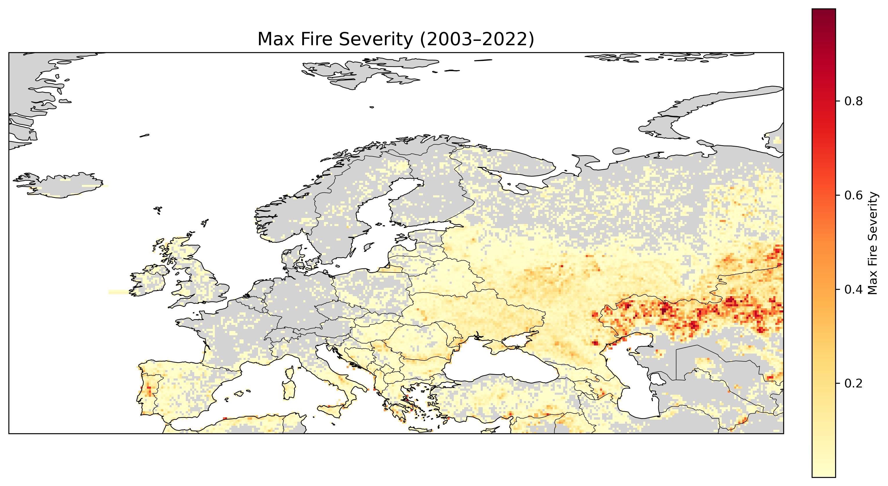

*Maximum fire severity 2003–2022 for all burned cells: share of the burnable area in each 0.25° cell that burned.*

In most of Europe, fires burned only a **small share** of a cell's burnable area; the most severe fires, burning more than half of a cell, occurred mainly in the **steppe of northern Kazakhstan and southern Russia**.

  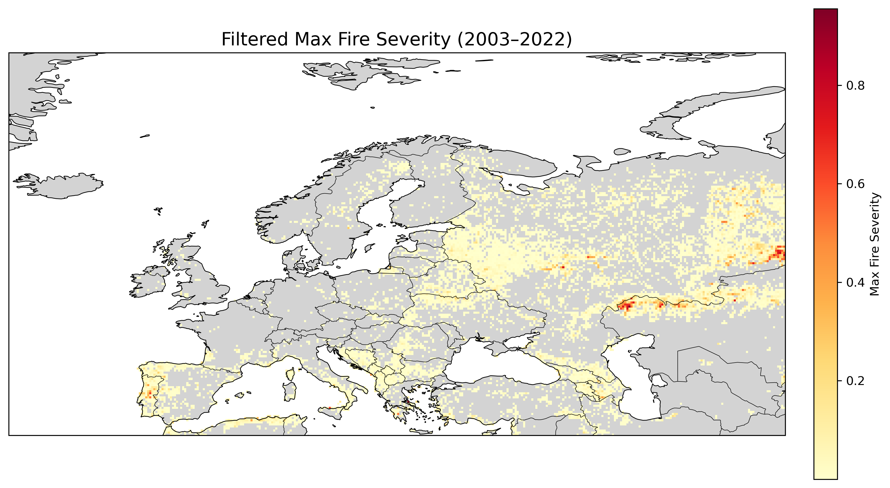

*Maximum fire severity 2003–2022 for the cells kept after the quality and land-cover filters used in the analysis.*

After filtering for only forest land-cover classes, far fewer cells remain, and most of them show **low to moderate severity**, which is typical of forest fires that affect only part of a 25 km grid cell.

#### Back to baseline?
The time series and the recovery map below are based on **NDVI**.

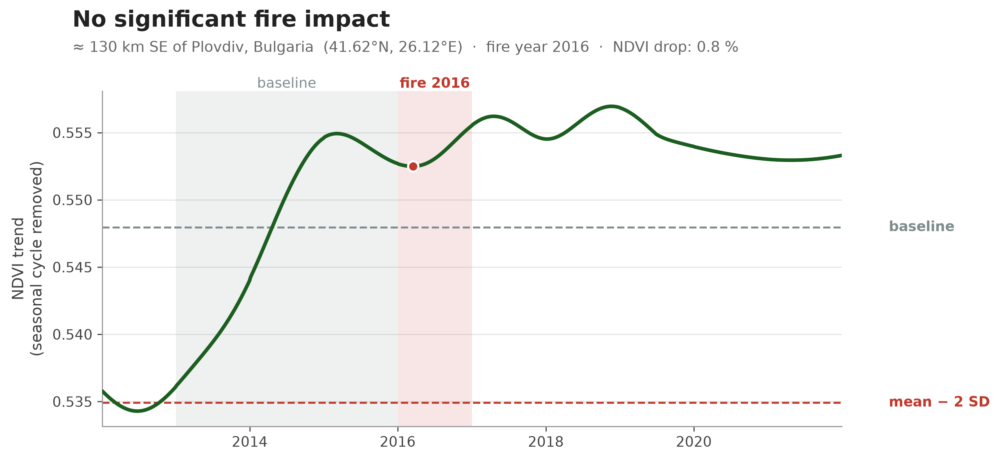

**Bulgaria, fire 2016:** NDVI barely changed and stayed above the baseline, so the fire had **no significant impact** on this cell.

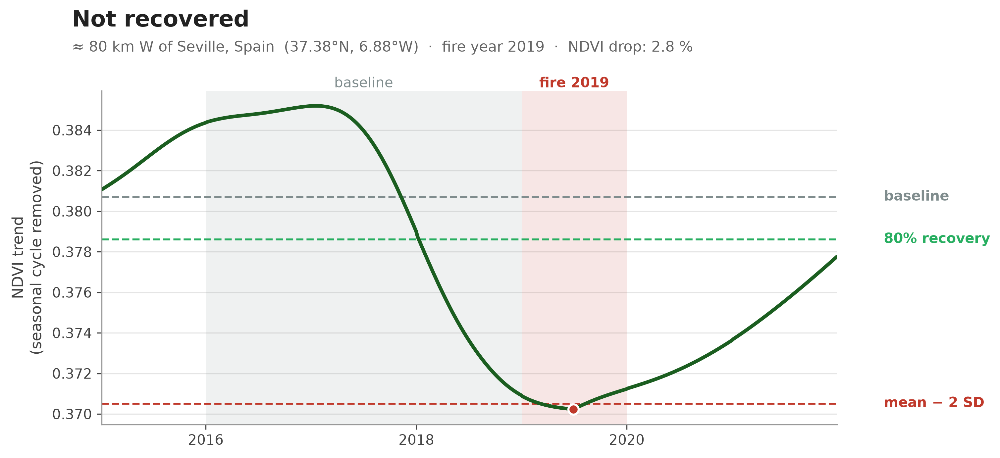

**Spain, fire 2019:** NDVI fell sharply around the fire and has only started to rise again by the end of the record in 2021.

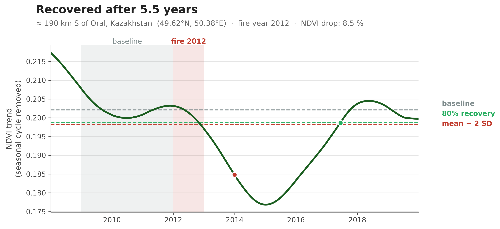

**Kazakhstan, fire 2012:** NDVI dropped by 8.5 % and kept falling until 2015, but regained 80 % of its loss about **5.5 years** after the start of the fire year.

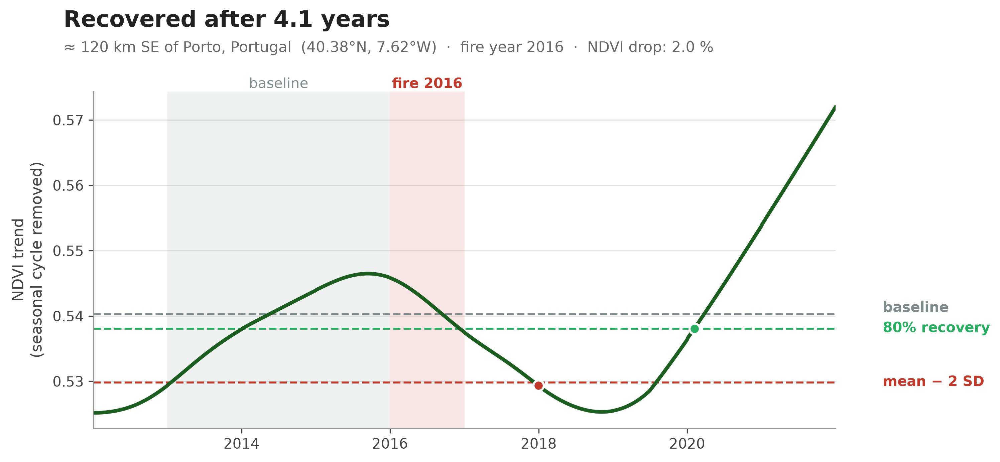

**Portugal, fire 2016:** a small drop of 2 % that recovered after about **4 years**, after which NDVI rose well above its pre-fire level.

*NDVI trend (seasonal cycle removed) of four burned cells. The first two cells recovered. The third has not recovered within the roughly two years of data available after its fire in 2019. The fourth shows no significant fire impact. Grey band: the three years before the fire (baseline). Red band: the fire year. Dashed lines: baseline level (grey), threshold for a significant drop (red), 80 % recovery line (green). Red dot: lowest value within 24 months after the start of the fire year, used to measure the drop; the trend can keep falling after this window. Green dot: the moment 80 % of the loss is regained.*

  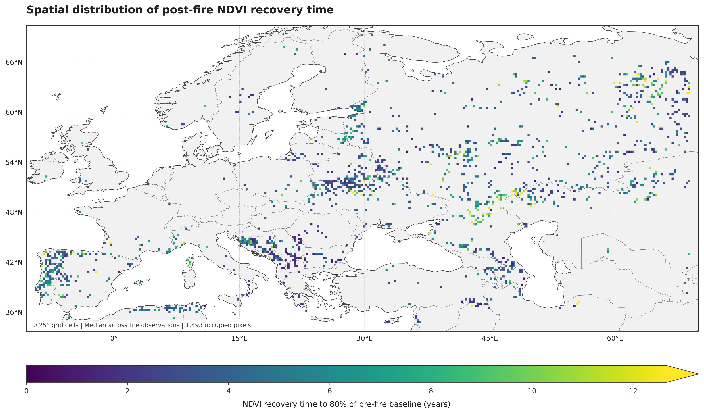

*Spatial distribution of post-fire NDVI recovery time across Europe: the median number of years until burned cells regained at least 80 % of their fire-induced NDVI loss. Values are shown on the 0.25° grid; multiple observations within the same cell are aggregated using the median. Only cells that recovered are shown.*

Most cells recover within **two to four years**, particularly on the Iberian Peninsula, in the Balkans and in Belarus and Ukraine, with a subtle trend towards **longer recovery times in the east** of the study area.

#### What bounces back fastest?
How does recovery differ between **land-cover types**? These charts combine the results of all three vegetation indicators.

  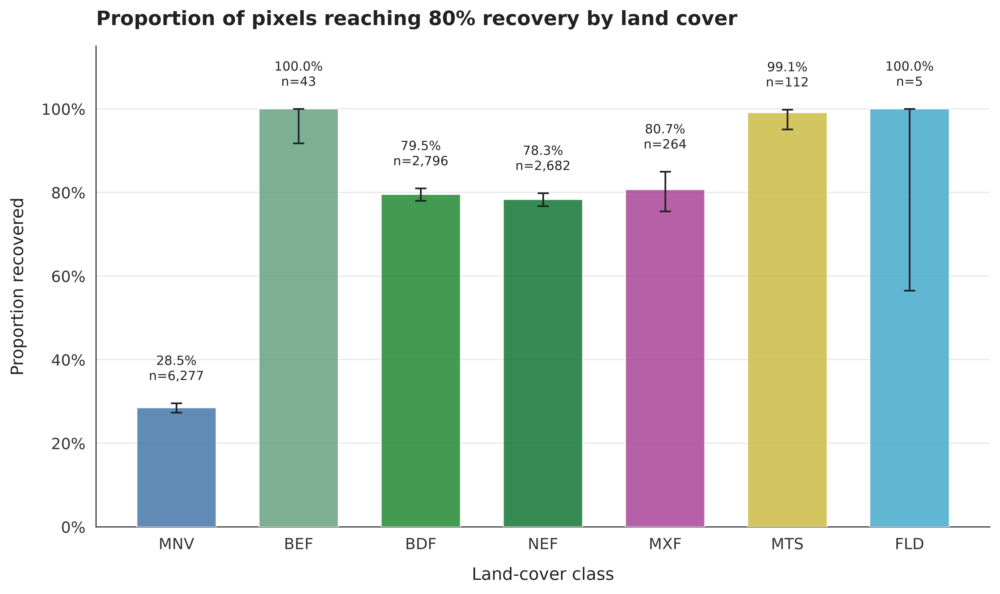

*Share of significantly disturbed cells that regained 80 % of their loss, per land-cover class, with 95 % confidence intervals. MNV = mosaic natural vegetation, BEF = broadleaved evergreen forest, BDF = broadleaved deciduous forest, NEF = needle-leaved evergreen forest, MXF = mixed forest, MTS = mosaic tree and shrub, FLD = flooded forest.*

Around **80 %** of disturbed broadleaved deciduous, needle-leaved and mixed forest cells recovered, but only **28.5 %** of mosaic natural vegetation; the near-100 % rates of BEF, MTS and FLD rest on few cells (n = 5 to 112).

  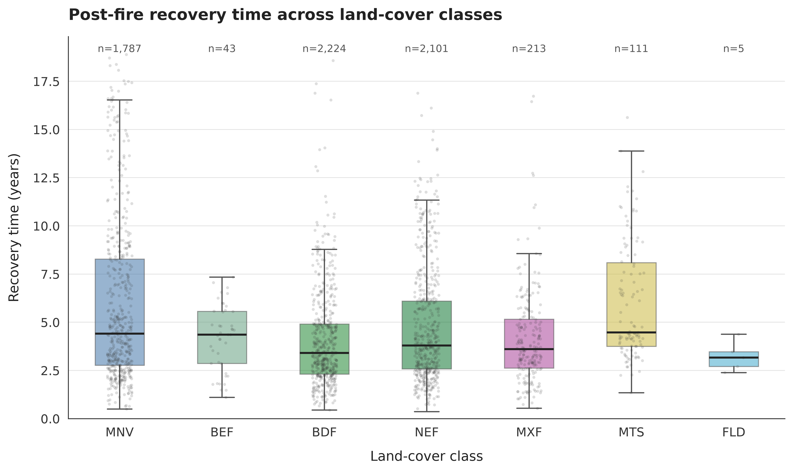

*Recovery time per land-cover class. Boxes show the median and interquartile range, points show individual cell–indicator observations.*

Median recovery times lie between about **3 and 4.5 years** for all classes, with BDF and NEF recovering fastest among the large classes and BEF, MNV and MTS slowest.

  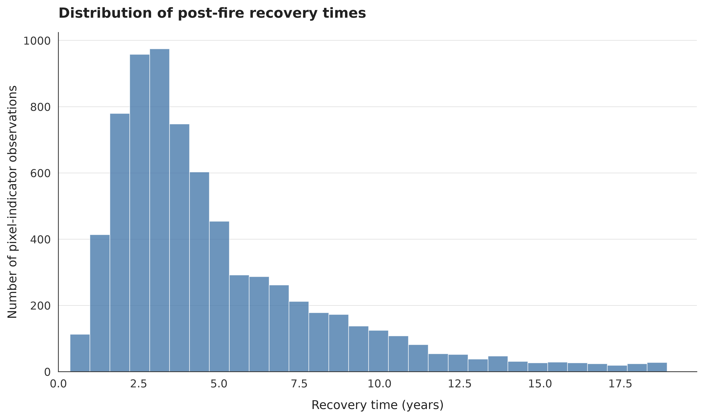

*Distribution of recovery times across all recovered cell–indicator observations.*

Most recoveries take **2.5 to 3.5 years**, but the long tail shows that some cells needed **more than 15 years**.

#### Does the indicator matter?
Each vegetation indicator sees a different side of the vegetation: **NDVI** measures greenness, **kNDVI** is less prone to saturation in dense vegetation, and **NIRv** is closely linked to canopy structure and productivity. Do they tell the same story?

  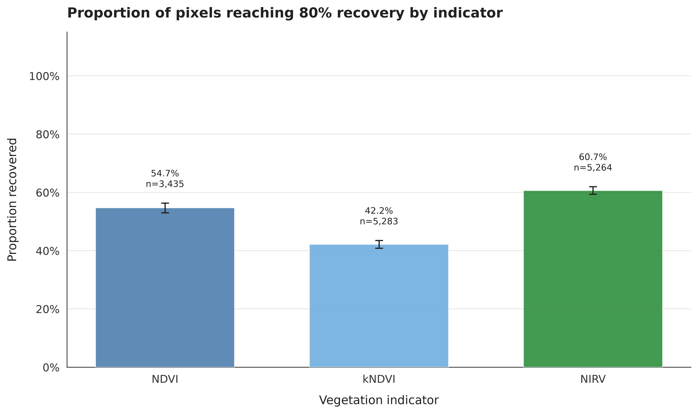

*Share of significantly disturbed cells that regained 80 % of their loss, per vegetation indicator, with 95 % confidence intervals.*

The indicators disagree on **how often** recovery is reached: **60.7 %** of disturbed cells recovered according to NIRv, **54.7 %** according to NDVI and only **42.2 %** according to kNDVI.

  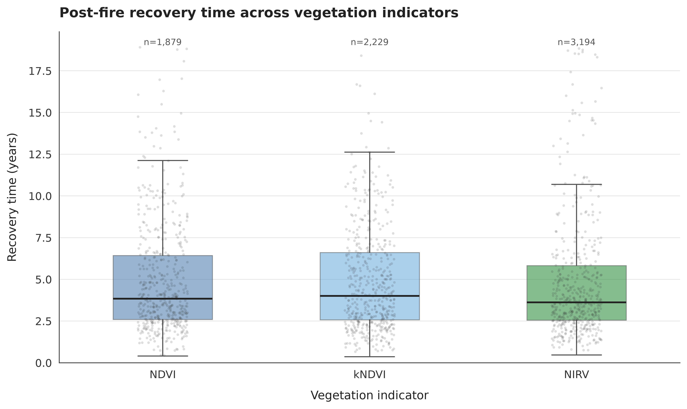

*Recovery time per vegetation indicator. Boxes show the median and interquartile range.*

The **timing** of recovery, in contrast, is very similar, with medians of about **3.5 to 4 years** for all three indicators, so whether a forest counts as "back to baseline" depends partly on **which lens** we look through.

## Data and Methods

#### Datasets
Burned areas come from the **ESA CCI Fire** gridded burned-area product. Vegetation dynamics were analysed with **three vegetation indicators** from the **Earth System Data Cube (ESDC) v3.0.1**, provided through DeepESDL. Both datasets share the same **0.25° grid (about 25 km)**, so every burned grid cell can be matched directly to its vegetation time series.

| **Dataset** | **What it measures** | **Source** | **Resolution** | **Period used** | **Used for** |
| --- | --- | --- | --- | --- | --- |
| **ESA CCI Fire Burned Area** (gridded, v5.1) | Burned area per grid cell, also split by vegetation class | MODIS Terra | 0.25°, monthly | 2003–2022 | Burned cells, fire year, fire severity and dominant vegetation type |
| **NDVI** | Vegetation greenness and photosynthetic activity | MODIS Terra/Aqua (MCD43C4, C6.1) | 0.25°, 8 days | 2000–2021 | Vegetation indicator: baseline, fire impact, recovery |
| **kNDVI** | Non-linear NDVI, less prone to saturation in dense vegetation | MODIS Terra/Aqua (MCD43C4, C6.1) | 0.25°, 8 days | 2000–2021 | Vegetation indicator: baseline, fire impact, recovery |
| **NIRv** | Near-infrared reflectance of vegetation, linked to canopy structure and productivity | MODIS Terra/Aqua (MCD43C4, C6.1) | 0.25°, 8 days | 2000–2021 | Vegetation indicator: baseline, fire impact, recovery |

The vegetation types come directly from the Fire CCI product, which reports for each cell how much of the burned area fell into each land-cover class. Each burned cell is assigned the class with the **largest burned area**.

#### Methodology workflow

  

    
🔥

    
1. Burned cells

    
ESA CCI Fire + quality filters

  

  
➜

  

    
📈

    
2. Vegetation indices

    
3 ESDC indicators STL → trend

  

  
➜

  

    
📏

    
3. Pre-fire baseline

    
mean ± SD 3 years before fire

  

  
➜

  

    
⚡

    
4. Fire impact

    
drop below mean − 2 SD?

  

  
➜

  

    
🌱

    
5. Recovery

    
80 % of loss regained? months to recovery

  

  
➜

  

    
🌳

    
6. Land-cover comparison

    
recovery times by land-cover class

  

1. **Burned cells:** select all 0.25° cells in Europe that burned between 2003 and 2022 in the ESA CCI Fire product. To keep only reliable, clearly burned cells, a cell must have at least **90 % observed area**, at least **70 % burnable area** and at least **1 km² burned area**, and its dominant burned vegetation class must be a **forest or natural-vegetation class**: mosaic natural vegetation, broadleaved evergreen, broadleaved deciduous, needle-leaved or mixed forest, mosaic tree and shrub, or flooded forest (croplands, grasslands, shrublands, sparse vegetation, urban and other classes are excluded). **Fire severity** is the fraction of a cell's burnable area that burned: the burned area (m²) divided by the burnable area, which is the calculated area of the 0.25° cell multiplied by its fraction of burnable area (both from the Fire CCI product).
2. **Time series and preprocessing:** extract the 8-day time series of the three vegetation indicators (NDVI, kNDVI, NIRv) for each burned cell and decompose them with **STL** (Seasonal-Trend decomposition using Loess). All further steps use the **trend** component, i.e. the signal with the seasonal cycle removed. Cells with more than 20 % missing values are skipped.
3. **Pre-fire baseline:** the mean and standard deviation of the trend over the **three years before the fire year**.
4. **Fire impact:** the impact is **significant** if the lowest trend value within **24 months** after the start of the fire year falls more than **two standard deviations** below the baseline mean.
5. **Recovery:** a cell counts as **recovered** once its trend has regained **80 % of the fire-induced loss**. Recovery time is counted in months from the start of the fire year. This follows the 80 % benchmark of [White et al. (2017)](https://doi.org/10.1016/j.rse.2017.03.035), scaled by the size of the disturbance as in the Recovery Indicator ([Kennedy et al., 2012](https://doi.org/10.1016/j.rse.2011.09.024)), because vegetation-index drops are much smaller than the NBR drops that the original metric was designed for.
6. **Land-cover comparison:** recovery times are compared between the dominant **land-cover classes** of the burned cells.

## Conclusions
#### Key findings
- **Recovery proportions differ between land-cover classes.** Broadleaved evergreen forest (BEF), mosaic tree and shrub (MTS) and flooded forest (FLD) show a recovery proportion close to **100 %**, with nearly all evaluated cells regaining at least 80 % of their fire-induced loss. These classes have considerably smaller sample sizes than the others, so their high rates should be interpreted cautiously. Most of the remaining classes recover in about **80 %** of cases, whereas mosaic natural vegetation (MNV) has the lowest rate, at around **30 %**.
- **Recovery times vary between land-cover classes.** BEF, MNV and MTS have the longest median recovery times, at around **4.5 years**. Broadleaved deciduous (BDF) and needle-leaved evergreen forests (NEF) recover faster, with median recovery times of about **3.5 to 4 years**.
- **Recovery times are broadly consistent across vegetation indicators.** NDVI, kNDVI and NIRv all show similar median recovery times of about **3.5 to 4 years**. The three indicators therefore capture broadly comparable patterns of post-fire vegetation recovery, despite measuring different aspects of vegetation.

#### Limitations
- **Spatial resolution:** the 0.25° resolution is a major limitation. At this scale, a grid cell covers a large, heterogeneous area that can combine burned and unburned vegetation, different forest types and varying fire severity. The observed response therefore cannot necessarily be attributed to the burned forest itself. This limits the spatial detail at which post-fire dynamics can be resolved and adds uncertainty to the recovery times.
- **Recovery is not ecological restoration:** the metric describes how much of the fire-induced loss in a vegetation indicator has been regained (at least 80 %), not the restoration of the original ecosystem. A rise in NDVI may reflect understory regrowth or pioneer vegetation, even if the original canopy structure, species composition or ecological functions have not recovered. The results describe the recovery of **remotely sensed vegetation conditions**, not complete ecosystem recovery.
- **Land-cover differences need careful interpretation:** the high recovery rates of BEF, MTS and FLD must be seen in light of their much smaller sample sizes. The relatively high recovery rates of some needle-leaved forest classes may also differ from expectations based on literature that suggests lower post-fire resilience than in broadleaved forests. Such comparisons, however, depend strongly on how resilience is defined and measured, and differences in geographic distribution, fire characteristics, forest composition and spatial resolution may contribute as well.

#### Future work
- **Higher-resolution satellite products** would help to separate burned forest from surrounding vegetation and to capture spatially heterogeneous recovery.
- **Combining greenness indicators with biomass, canopy structure and species composition** would give a more complete picture of ecosystem recovery.
- **Larger and more balanced samples** across land-cover classes, together with information on fire severity and pre-fire conditions, would help to explain differences in recovery trajectories.
- **Comparing recovery across climatic and biogeographical regions** could reveal how environmental conditions shape post-fire vegetation dynamics.

## Open Science
| **Name** | **Type** | **Agency / Provider** | **Description / Usage** |
| --- | --- | --- | --- |
| **[ESA CCI Fire Burned Area (gridded, v5.1)](https://climate.esa.int/en/projects/fire/)** | Dataset | ESA Climate Change Initiative | Monthly burned area on a 0.25° grid (`ESACCI-L4_FIRE-BA-MODIS-2001-2022-fv5.1.zarr`), used for burned cells, fire year, fire severity and dominant vegetation type. |
| **[Earth System Data Cube v3.0.1](https://www.earthsystemdatalab.net/)** | Dataset | DeepESDL / ESDC | Vegetation indicators NDVI, kNDVI and NIRv at 0.25° and 8 days (`esdc-8d-0.25deg-1x720x1440-3.0.1.zarr`), used to derive the pre-fire baseline, fire impact and recovery. |
| **[DeepESDL](https://www.earthsystemdatalab.net/)** | Platform | ESA / Brockmann Consult | Cloud-based Jupyter environment used for data access, time-series extraction and the full analysis workflow. |
| **[EO Dashboard](https://eodashboard.org/explore/?x=15.0000&y=48.0000&z=4.0000&datetime=2025-09-19&template=expert)** | Platform | EO Dashboard Consortium (ESA, NASA, JAXA) | Base layers, NDVI map layer and the narrative editor used to present this story. |
| **[statsmodels](https://www.statsmodels.org/)** | Tool | Open source | STL decomposition of the vegetation time series. |
| **[xcube](https://xcube.readthedocs.io/)** | Tool | Open source | Access to the Earth System Data Cube on DeepESDL. |
| **[ESA Climate Toolbox](https://climate.esa.int/en/data/toolbox/)** | Tool | ESA Climate Change Initiative | Access to the ESA CCI Fire product. |
| **xarray, pandas, matplotlib, seaborn, cartopy** | Tool | Open source | Data handling, plots and maps. |

#### Notebook
Access the notebook to reproduce the study workflow.
<iframe width="100%" height="600" src="https://jupyterhub.deepesdl-v2.eox.at/hub/user-redirect/lab/tree/sciencehub-challenges-user-data/processing/team-3/main.ipynb" frameborder="0"></iframe>

#### References
- Forzieri, G., Dakos, V., McDowell, N. G., Ramdane, A., & Cescatti, A. (2022). Emerging signals of declining forest resilience under climate change. *Nature*, 608, 534–539. https://doi.org/10.1038/s41586-022-04959-9

- Johnstone, J. F., Allen, C. D., Franklin, J. F., Frelich, L. E., Harvey, B. J., Higuera, P. E., Mack, M. C., Meentemeyer, R. K., Metz, M. R., Perry, G. L. W., Schoennagel, T., & Turner, M. G. (2016). Changing disturbance regimes, ecological memory, and forest resilience. *Frontiers in Ecology and the Environment*, 14, 369–378. https://doi.org/10.1002/fee.1311

- Kennedy, R. E., Yang, Z., Cohen, W. B., Pfaff, E., Braaten, J., & Nelson, P. (2012). Spatial and temporal patterns of forest disturbance and regrowth within the area of the Northwest Forest Plan. *Remote Sensing of Environment*, 122, 117–133. https://doi.org/10.1016/j.rse.2011.09.024

- Reek, J. E., Zohner, C. M., Smith, G. R., Cook-Patton, S. C., De Frenne, P., D'Odorico, P., Floriancic, M. G., Jackson, R. B., Jones, J. A., Kirchner, J. W., et al. (2026). More than mitigation: The role of forests in climate adaptation. *Science*, 391(6786), 669–678. https://doi.org/10.1126/science.ads4361

- Seidl, R., Spies, T. A., Peterson, D. L., Stephens, S. L., & Hicke, J. A. (2016). Searching for resilience: addressing the impacts of changing disturbance regimes on forest ecosystem services. *Journal of Applied Ecology*, 53(1), 120–129. https://doi.org/10.1111/1365-2664.12511

- Watson, J. E. M., Evans, T., Venter, O., Williams, B., Tulloch, A., Stewart, C., Thompson, I., Ray, J. C., Murray, K., Salazar, A., McAlpine, C., Potapov, P., Walston, J., Robinson, J. G., Painter, M., Wilkie, D., Filardi, C., Laurance, W. F., Houghton, R. A., … Lindenmayer, D. (2018). The exceptional value of intact forest ecosystems. *Nature Ecology & Evolution*, 2, 599–610. https://doi.org/10.1038/s41559-018-0490-x

- White, J. C., Wulder, M. A., Hermosilla, T., Coops, N. C., & Hobart, G. W. (2017). A nationwide annual characterization of 25 years of forest disturbance and recovery for Canada using Landsat time series. *Remote Sensing of Environment*, 194, 303–321. https://doi.org/10.1016/j.rse.2017.03.035

## Contributors
| **Role** | **Name** |
| --- | --- |
| Authors | Jakob Everke, Kyzer Gerez, Jonas Siethoff |