# Vegetation response to atmosphere-ocean circulations <!--{ as="img" mode="hero" src="https://raw.githubusercontent.com/ESA-eodashboards/eodashboard-narratives/89c699125d9c76a3a02b0a52d76c74bde174dc36/assets/thmimif/titleimage-1795163269394.jpg") }--> 
## Authors: Theresa Mimi Freiß¹, Thomas Himmer¹ and Fabian Unterasinger¹ <!--{ style="font-size:1.5rem;opacity:0.7;margin-top:1rem;" }-->
> ¹ Vienna University of Technology

*This story is based on results from the Science Hub Challenges organised and hosted by ESA's ESRIN Science Hub in **November 2026**. It was developed by a team from the **Vienna University of Technology**.*

## 

  

## Challenge
Atmosphere-ocean circulations significantly impact our environmental and socioeconomic systems worldwide. The [El Niño-Southern Oscillation (ENSO)](https://www.noaa.gov/jetstream/tropical/enso) is one of the most influential climate variations, altering weather patterns across the globe. Year-to-year conditions in the tropical Pacific Ocean fluctuate between unusually warm (El Niño) and cold (La Niña) phases. These fluctuations, typically spanning two to seven years, disrupt atmospheric pressure patterns between the tropical Indian and Pacific Oceans. The resulting shifts in environmental conditions directly influence primary production patterns within the global carbon cycle. This challenge investigates the sensitivity of vegetation to these atmosphere-ocean circulations.

## Objective
This study aims to quantify the impact of ENSO phases (La Niña and El Niño) on vegetation dynamics compared to neutral baseline conditions. 
By analyzing timeseries of climate oscillation indices alongside vegetation specific Earth observation data, we seek to identify the spatio-temporal scales at which vegetation exhibits a response to ENSO-driven forcing.

## Earth observations <!--{ as="eox-map" mode="tour" }-->

### <!--{ layers='[{"type":"Group","properties":{"id":"BaseLayersGroup","title":"Base Layers"},"layers":[{"type":"Tile","properties":{"id":"cloudless-2024;:;EPSG:3857","title":"EOxCloudless 2024"},"source":{"type":"XYZ","url":"//s2maps-tiles.eu/wmts/1.0.0/s2cloudless-2024_3857/default/g/{z}/{y}/{x}.jpeg","projection":"EPSG:3857"},"visible":true},{"type":"Tile","properties":{"id":"OSM;:;EPSG:3857","title":"OSM Background"},"source":{"type":"XYZ","url":"//s2maps-tiles.eu/wmts/1.0.0/osm_3857/default/g/{z}/{y}/{x}.jpeg","projection":"EPSG:3857"},"visible":false},{"type":"Tile","properties":{"id":"terrain-light;:;EPSG:3857","title":"Terrain Light"},"source":{"type":"XYZ","url":"//s2maps-tiles.eu/wmts/1.0.0/terrain-light_3857/default/g/{z}/{y}/{x}.jpeg","projection":"EPSG:3857"},"visible":false},{"type":"Group","properties":{"id":"AnalysisGroup","title":"Data Layers"},"layers":[{"type":"Tile","properties":{"id":"ESDC_gross_primary_productivity;:;2021-12-23T00:00:00Z;:;xcube tiles;:;EPSG:3857","title":"xcube tiles"},"source":{"type":"XYZ","url":"https://api.earthsystemdatalab.net/api/tiles/esdc/gross_primary_productivity/{z}/{y}/{x}?crs=EPSG:3857&time=2021-12-23T00:00:00Z&vmin=0&vmax=1&cbar=RdYlGn","projection":"EPSG:3857"}},{"type":"Group","properties":{"id":"OverlayGroup","title":"Overlay Layers"},"layers":[{"type":"Tile","properties":{"id":"overlay_bright;:;EPSG:3857","title":"Overlay labels"},"source":{"type":"XYZ","url":"//s2maps-tiles.eu/wmts/1.0.0/overlay_base_bright_3857/default/g/{z}/{y}/{x}.png","projection":"EPSG:3857"}}]}]}]}]' zoom="2.6456584324087107" center=[15.569682342641302,7.8903138332408105] projection="" animationOptions={duration:1000}}-->
#### Global scale
The global perspective allows us to broadly observe climate anomalies and their relationship to vegetation growth and health. By utilizing coarse-resolution data, we can identify large-scale trends and regional or temporal differences.

### <!--{ layers='[{"type":"Group","properties":{"id":"BaseLayersGroup","title":"Base Layers"},"layers":[{"type":"Tile","properties":{"id":"cloudless-2024;:;EPSG:3857","title":"EOxCloudless 2024"},"source":{"type":"XYZ","url":"//s2maps-tiles.eu/wmts/1.0.0/s2cloudless-2024_3857/default/g/{z}/{y}/{x}.jpeg","projection":"EPSG:3857"},"visible":true},{"type":"Tile","properties":{"id":"OSM;:;EPSG:3857","title":"OSM Background"},"source":{"type":"XYZ","url":"//s2maps-tiles.eu/wmts/1.0.0/osm_3857/default/g/{z}/{y}/{x}.jpeg","projection":"EPSG:3857"},"visible":false},{"type":"Tile","properties":{"id":"terrain-light;:;EPSG:3857","title":"Terrain Light"},"source":{"type":"XYZ","url":"//s2maps-tiles.eu/wmts/1.0.0/terrain-light_3857/default/g/{z}/{y}/{x}.jpeg","projection":"EPSG:3857"},"visible":false},{"type":"Group","properties":{"id":"AnalysisGroup","title":"Data Layers"},"layers":[{"type":"Tile","properties":{"id":"ESDC_gross_primary_productivity;:;2021-12-23T00:00:00Z;:;xcube tiles;:;EPSG:3857","title":"xcube tiles"},"source":{"type":"XYZ","url":"https://api.earthsystemdatalab.net/api/tiles/esdc/gross_primary_productivity/{z}/{y}/{x}?crs=EPSG:3857&time=2021-12-23T00:00:00Z&vmin=0&vmax=1&cbar=RdYlGn","projection":"EPSG:3857"}},{"type":"Group","properties":{"id":"OverlayGroup","title":"Overlay Layers"},"layers":[{"type":"Tile","properties":{"id":"overlay_bright;:;EPSG:3857","title":"Overlay labels"},"source":{"type":"XYZ","url":"//s2maps-tiles.eu/wmts/1.0.0/overlay_base_bright_3857/default/g/{z}/{y}/{x}.png","projection":"EPSG:3857"}}]}]}]}]' zoom="2.9" center=[-140,-5.8903138332408105] projection="" animationOptions={duration:1000}}-->
#### ENSO
In the tropical Pacific-Indian Ocean interaction zone, ENSO dynamics drive major shifts in atmospheric pressure and sea surface temperatures. The [Relative Oceanic Niño Index (RONI)](https://www.ncei.noaa.gov/access/monitoring/enso/sst#roni) serves as a key indicator, distinguishing between El Niño (warm) and La Niña (cold) conditions.

<figcaption>***Fig. 1:*** *Relative Oceanic Niño Index (RONI) from 1950 to 2026 indicating warm El Niño (positive, red) and cold La Niña (negative, blue) periods.*</figcaption>

These ENSO-driven variations in climate conditions result in altered weather patterns globally. Seasonal differences reveal whether an El Niño or La Niña period occurs.

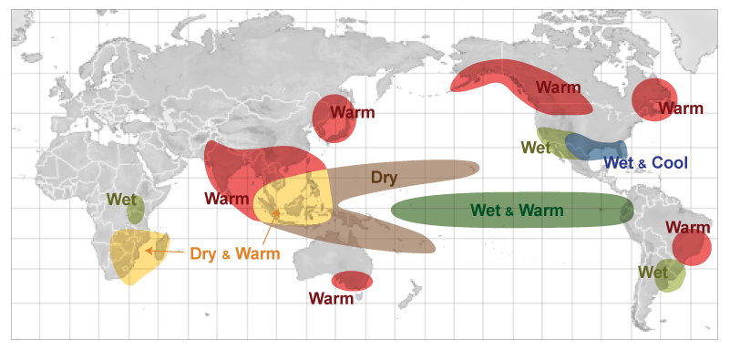<figcaption>***Fig. 2:*** *El Niño effects from December to February (see [Weather Impacts of ENSO](https://www.noaa.gov/jetstream/enso_impacts)).*</figcaption>

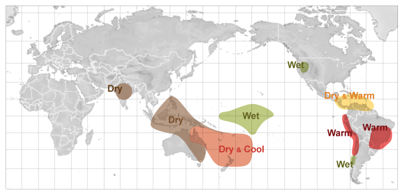<figcaption>***Fig. 3:*** *El Niño effects from June to August (see [Weather Impacts of ENSO](https://www.noaa.gov/jetstream/enso_impacts)).*</figcaption>

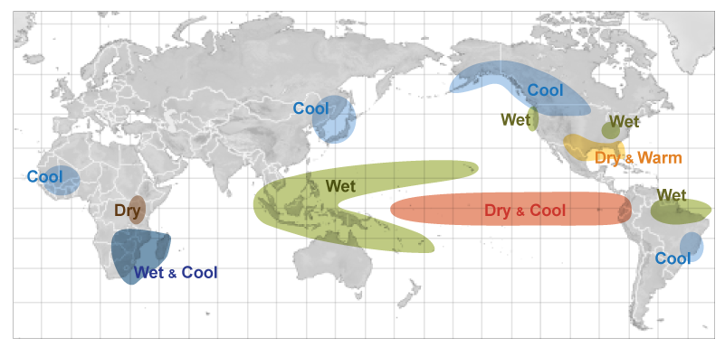<figcaption>***Fig. 4:*** *La Niña effects from December to February (see [Weather Impacts of ENSO](https://www.noaa.gov/jetstream/enso_impacts)).*</figcaption>

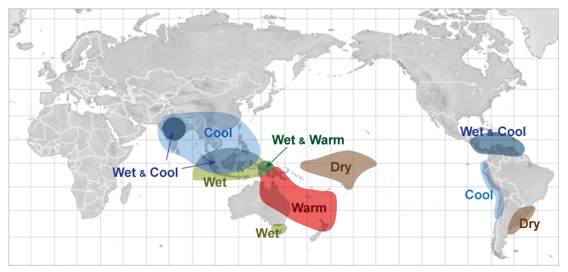<figcaption>***Fig. 5:*** *La Niña effects from June to August (see [Weather Impacts of ENSO](https://www.noaa.gov/jetstream/enso_impacts)).*</figcaption>

### <!--{ layers='[{"type":"Group","properties":{"id":"BaseLayersGroup","title":"Base Layers"},"layers":[{"type":"Tile","properties":{"id":"cloudless-2024;:;EPSG:3857","title":"EOxCloudless 2024"},"source":{"type":"XYZ","url":"//s2maps-tiles.eu/wmts/1.0.0/s2cloudless-2024_3857/default/g/{z}/{y}/{x}.jpeg","projection":"EPSG:3857"},"visible":true},{"type":"Tile","properties":{"id":"OSM;:;EPSG:3857","title":"OSM Background"},"source":{"type":"XYZ","url":"//s2maps-tiles.eu/wmts/1.0.0/osm_3857/default/g/{z}/{y}/{x}.jpeg","projection":"EPSG:3857"},"visible":false},{"type":"Tile","properties":{"id":"terrain-light;:;EPSG:3857","title":"Terrain Light"},"source":{"type":"XYZ","url":"//s2maps-tiles.eu/wmts/1.0.0/terrain-light_3857/default/g/{z}/{y}/{x}.jpeg","projection":"EPSG:3857"},"visible":false},{"type":"Group","properties":{"id":"AnalysisGroup","title":"Data Layers"},"layers":[{"type":"Tile","properties":{"id":"ESDC_gross_primary_productivity;:;2021-12-23T00:00:00Z;:;xcube tiles;:;EPSG:3857","title":"xcube tiles"},"source":{"type":"XYZ","url":"https://api.earthsystemdatalab.net/api/tiles/esdc/gross_primary_productivity/{z}/{y}/{x}?crs=EPSG:3857&time=2021-12-23T00:00:00Z&vmin=0&vmax=1&cbar=RdYlGn","projection":"EPSG:3857"}},{"type":"Group","properties":{"id":"OverlayGroup","title":"Overlay Layers"},"layers":[{"type":"Tile","properties":{"id":"overlay_bright;:;EPSG:3857","title":"Overlay labels"},"source":{"type":"XYZ","url":"//s2maps-tiles.eu/wmts/1.0.0/overlay_base_bright_3857/default/g/{z}/{y}/{x}.png","projection":"EPSG:3857"}}]}]}]}]' zoom="3.5" center=[-20,-13.8903138332408105] projection="" animationOptions={duration:1000}}-->
#### Anomalies
When analyzing the correlation between ENSO indices and vegetation indices anomalies, we observe distinct spatio-temporal patterns. Vegetation anomalies can coincide with ENSO-driven extreme precipitation shifts, possibly revealing sensitive regional ecosystems that experience (delayed) responses to ocean-atmospheric forcing.

In this study, we investigate the southeastern region of South America and Sub-Saharan Africa in greater detail.

## Data and Methods
#### Dataset
This study utilizes climate and vegetation indices to assess ecosystem sensitivity.

**NOAA Climate Oscillation Indices** (2001–2021, global scale, monthly resolution)
- **Relative Oceanic Niño Index (RONI):** A 3-month running mean of tropical-adjusted Niño 3.4 SST anomalies (1991–2020 base period)

**ESDC Vegetation Indices** (2001–2021, 0.25° and 1° spatial resolution, monthly temporal resolution)
- **Normalized Difference Vegetation Index (NDVI):** MODIS/Terra+Aqua BRDF/Albedo Nadir BRDF-Adjusted Reflectance Daily L3 Global 0.05 Deg CMG and Vegetation Indices
- **Near Infrared Reflectance of Vegetation (NIRv):** Derived from MODIS/Terra+Aqua BRDF/Albedo data
- **Gross Primary Productivity (GPP):** FLUXCOM

#### Methodology
The study is carried out first at a coarse global sclale to identify large-scale spatio-temporal patterns and trends.
Then two major areas are analyzed spacially in more detail: the southeastern region of South America and Sub-Saharan Africa.
Our analytical workflow includes:
1. **Data Retrieval:** Extraction of NOAA RONI indices and DeepESDL ESDC vegetation indices (NDVI, NIRv and GPP).
2. **Preprocessing:** Time-series extraction, spatio-temporal aggregation,  decomposition to remove mean seasonal cycle and linear trend. 
3. **Correlation Analysis:** Evaluation of lag-time correlation responses between ENSO indices and vegetation anomalies. Identification trends and anomalies. Phase-specific (El Niño vs. La Niña) analysis.
4. **Hotspot Identification:** Mapping geographical areas that show statistically significant vegetation response to ENSO. Creation of global maps southeastern South America and Sub-Saharan-Africa. Production of phase-specific (El Niño vs. La Niña) maps.

## Results
Our findings, derived from comparing NDVI, NIRv, and GPP vegetation indices against RONI, provide insight into vegetation response to ENSO at different scales.
The results comprise global and regional maps of lag-time correlation and regional timeseries, alongside phase-specific analyses that reveal how vegetation indices shift in response to El Niño and La Niña periods. Only the most pronounced responses are shown here. Further response analysis can be accessed via the notebook linked in the *Notebook* section.

### Global study
Global lagged correlation analysis between the Relative Oceanic Niño Index (RONI) and the three vegetation metrics (NDVI, NIRv, and GPP) reveals consistent, geographically coherent ENSO teleconnection patterns across tropical and subtropical land surfaces. Strong negative correlations (r < -0.5) at short lag times (0-4 months) dominate across Australia, Southeast Asia, India, southern Africa, and northern South America, reflecting rapid vegetation stress and reduced photosynthetic uptake during warm ENSO phases. Conversely, pronounced positive correlations (r > 0.5) with short-to-moderate lags occur in southern South America, the southwestern United States, eastern Africa, and Central Asia. Across the metrics, GPP and NIRv exhibit stronger and spatially more contiguous negative responses than NDVI over the Maritime Continent, northern Australia, and southern Africa. The pattern is clearly captured in the zonal median anomalies around 15°S-30°S and the meridional anomalies between 120°E and 150°E. Unlike the reflectance-based indices, GPP masks out barren, ice-covered, and hyper-arid regions (such as the Sahara, Greenland, and Antarctica), while northern high latitudes across all three datasets generally display weak correlations (|r| < 0.3) and longer, more heterogeneous optimal lag times.

#### NDVI vs. RONI

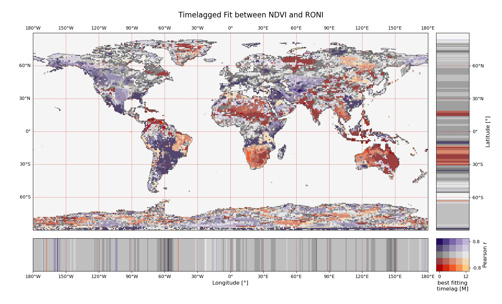<figcaption>***Fig. 6:*** *Global spatial distribution of the maximum absolute Pearson correlation coefficient (r, vertical legend axis) and corresponding optimal time lag in months (0-12 months, horizontal legend axis) between NDVI and the Relative Oceanic Niño Index (RONI). Right and bottom margin bands indicate zonal and meridional median values, respectively.*</figcaption>

#### NIRv vs. RONI

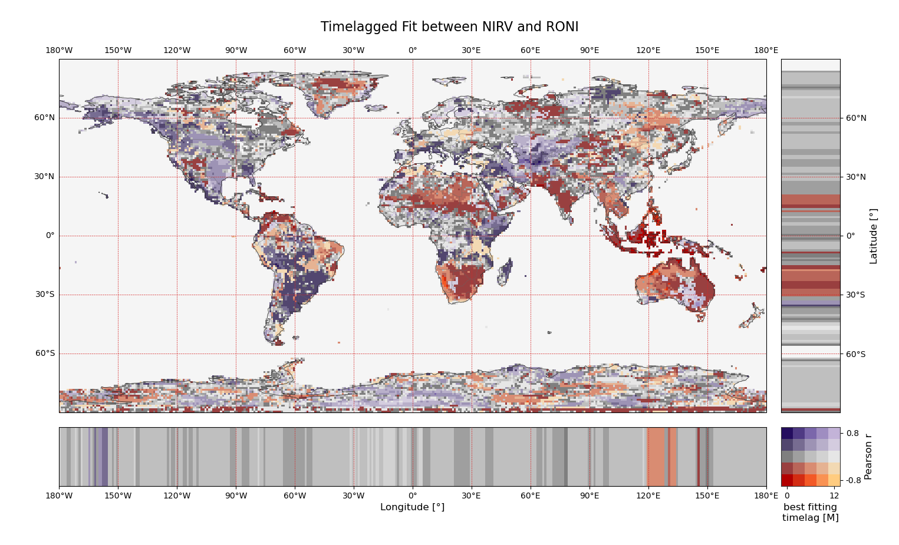<figcaption>***Fig. 7:*** *Same as Figure 6, but for the Near-Infrared Reflectance of Vegetation (NIRv) and RONI, showing enhanced negative responses across Southeast Asia and Australia.*</figcaption>

#### GPP vs. RONI

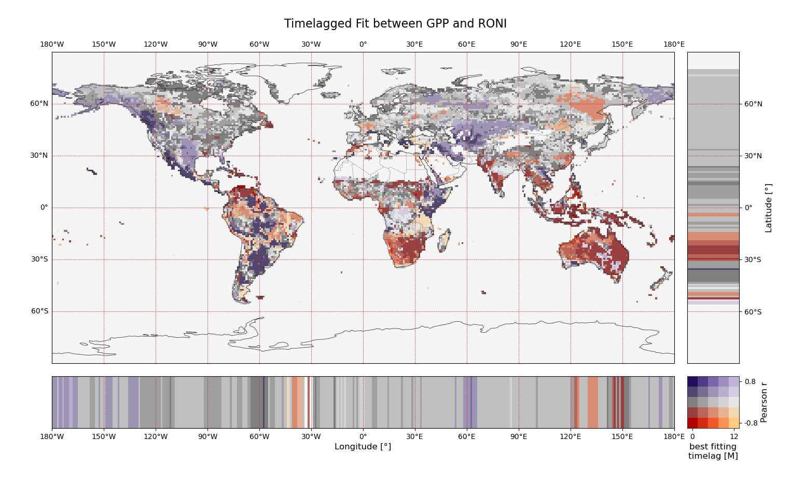<figcaption>***Fig. 8:*** *Same as Figure 6, but for GPP and RONI across vegetated land areas, highlighting pronounced short-lag reductions in primary productivity over Australia, southern Africa, and the Maritime Continent.*</figcaption>

The rest of the study focused on GPP due to the highest absolute values detected in further difference analysis.

#### Phase-specific analysis of GPP

Alongside other strongly affected regions worldwide Argentina, southern Africa, and eastern Africa exhibit pronounced, asymmetric GPP responses when stratified into El Niño (RONI > 0.5) and La Niña (RONI < -0.5) phases. During El Niño, positive correlations at short-to-moderate lags dominate across Argentina, whereas southern Africa shows positive correlations in the west and negative ones in the east. Under La Niña, strong short-lag negative correlations emerge across southern Africa - indicating marked productivity gains as RONI decreases - while eastern Africa shows positive correlations (i.e. GPP decreases) and Argentina also retains a localized positive signal (GPP decrease).

At a 3-month lag relative to neutral conditions, GPP anomalies exhibit stark sign reversals between El Niño and La Niña across the three primary study areas of Argentina, southern Africa, and eastern Africa. During El Niño, GPP anomalies are strongly positive ( > 0.15) across Argentina and eastern Africa, whereas southern Africa experiences pronounced productivity reductions ( < -0.15). Under La Niña, this spatial response completely inverts: strong negative anomalies emerge over Argentina and eastern Africa, while southern Africa shifts to marked positive GPP anomalies.  

##### El Niño 

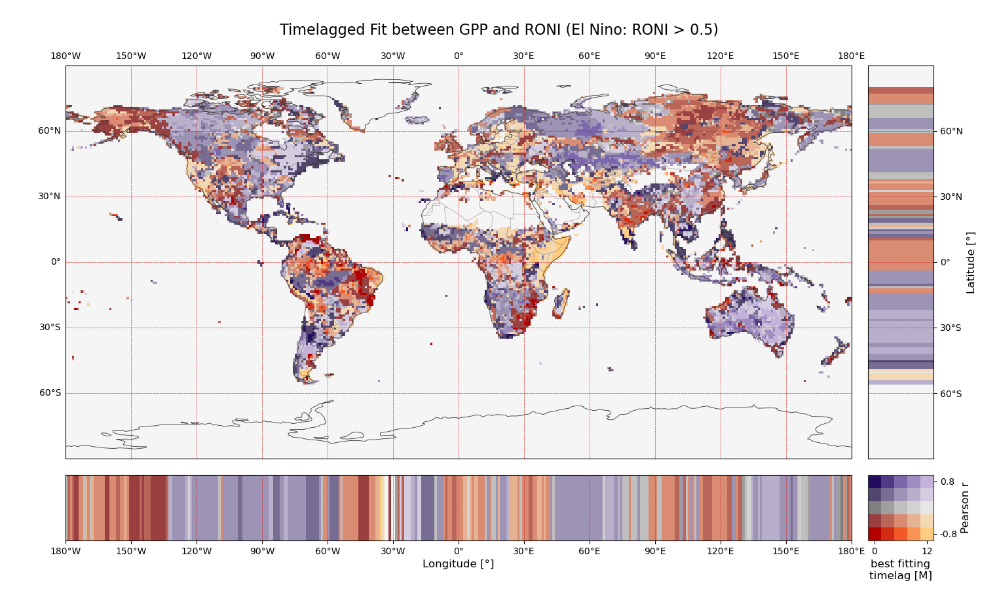<figcaption>***Fig. 9:*** *Global spatial distribution of the maximum absolute Pearson correlation coefficient (r, vertical legend axis) and corresponding optimal time lag in months (0-12 months, horizontal legend axis) between GPP and the Relative Oceanic Niño Index (RONI) under warm El Niño conditions (RONI > 0.5)*</figcaption>

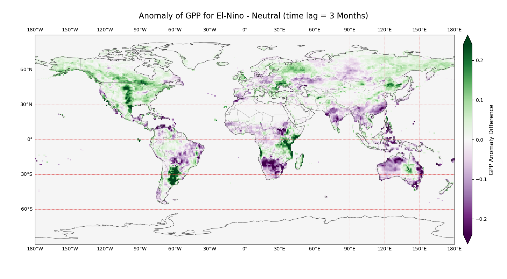<figcaption>***Fig. 10:*** *Global distribution of GPP anomaly differences between El Niño and neutral ENSO conditions at a 3-month time lag, highlighting positive anomalies in Argentina and eastern Africa and negative anomalies in southern Africa.*</figcaption>

<figcaption>***Fig. 11:*** *El Niño effects from December to February (for comparison, see [Weather Impacts of ENSO](https://www.noaa.gov/jetstream/enso_impacts)).*</figcaption>

<figcaption>***Fig. 12:*** *El Niño effects from June to August (for comparison, see [Weather Impacts of ENSO](https://www.noaa.gov/jetstream/enso_impacts)).*</figcaption>

##### La Niña

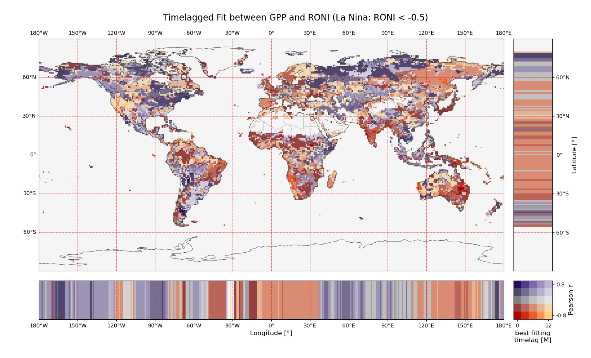<figcaption>***Fig. 13:*** *Same as Figure 9 but for La Nina conditions (RONI < -0.5).*</figcaption>

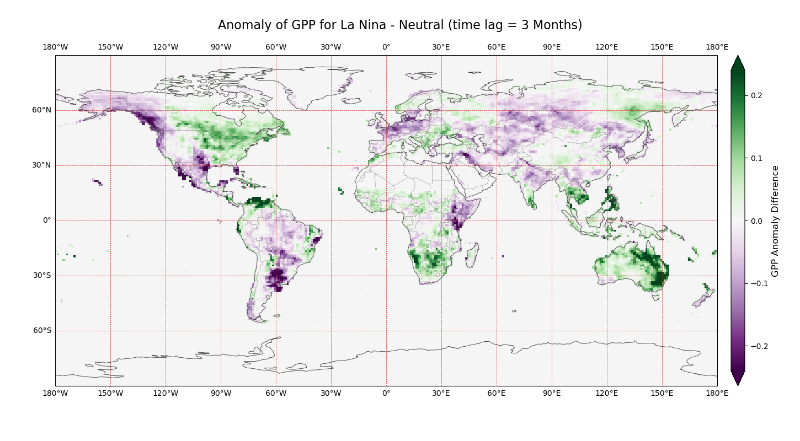<figcaption>***Fig. 14:*** *Global distribution of GPP anomaly differences between La Niña and neutral ENSO conditions at a 3-month time lag, illustrating the inverted GPP response across the three study regions.*</figcaption>

<figcaption>***Fig. 15:*** *La Niña effects from December to February (for comparison, see [Weather Impacts of ENSO](https://www.noaa.gov/jetstream/enso_impacts)).*</figcaption>

<figcaption>***Fig. 16:*** *La Niña effects from June to August (for comparison, see [Weather Impacts of ENSO](https://www.noaa.gov/jetstream/enso_impacts)).*</figcaption>

#### Regional GPP study

##### South America
In **central and northern Argentina (22°S-38°S)**, GPP exhibits robust positive correlations (r > 0.5) with RONI at short-to-moderate lags (2–6 months). At a 3-month lag, this relationship manifests as pronounced positive GPP anomalies ( > 0.2) during El Niño events and sharp productivity declines ( < -0.2) under La Niña conditions.

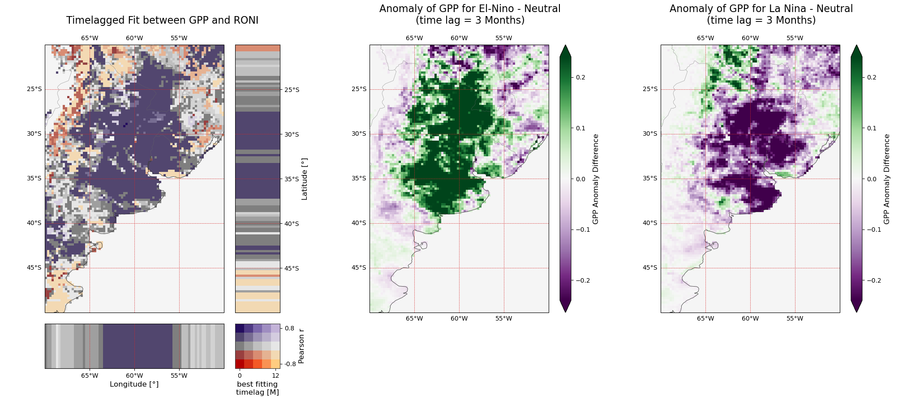<figcaption>***Fig. 17:*** *Time-lag correlations and anomaly analysis of GPP for central and northern Argentina.*</figcaption>

##### Sub-Saharan-Africa

**Eastern Africa** displays a distinct spatial dipole between coastal/equatorial lowlands and the northwestern interior. Coastal and equatorial zones show strong short-lag positive correlations accompanied by substantial El Niño productivity gains and La Niña deficits, whereas the northwestern highlands exhibit negative correlations and inverse phase anomalies.

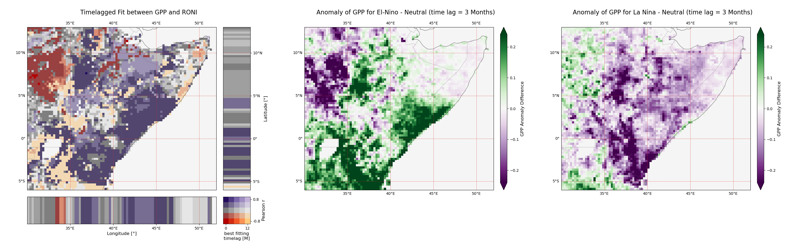<figcaption>***Fig. 18:*** *Time-lag correlations and anomaly analysis of GPP for eastern Africa.*</figcaption>

**Southern Africa** (15°S–32°S) is characterized by widespread short-lag (1–4 months) negative correlations (r < -0.5) across the interior. Consequently, the region experiences severe GPP reductions ( < -0.2) following El Niño events and marked productivity enhancements ( > 0.15) during La Niña phases.

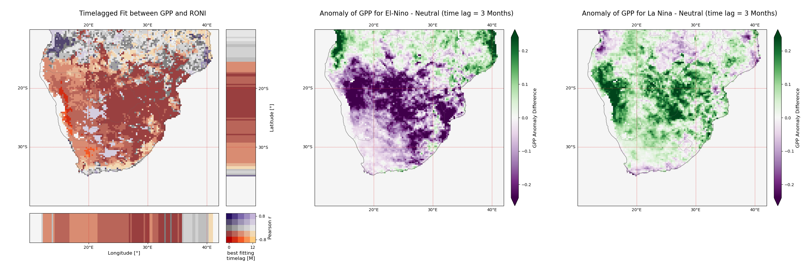<figcaption>***Fig. 19:*** *Time-lag correlations and anomaly analysis of GPP for southern Africa.*</figcaption>

## Conclusions
All in all, global and regional lag-time correlations of all three vegetation indices reveal strong regionally varying positive or negative responses to El Niño and La Niña patterns. In general, these vegetation responses coincide well with expected climate oscillation driven weather anomalies on both the global and investigated regional scale.

Lagged correlation and phase-composite analyses demonstrate that ENSO teleconnections exert a strong, rapid control on terrestrial GPP across Argentina, Eastern Africa, and Southern Africa within a 1- to 6-month window. These observed productivity anomalies closely align with expected ENSO-induced hydroclimatic regimes: wet and warm conditions during El Niño enhance photosynthetic uptake in central/northern Argentina and coastal Eastern Africa, whereas El Niño-associated drought and heat stress severely suppress GPP across interior Southern Africa. Conversely, La Niña inverts this spatial pattern, driving productivity declines under drier conditions in Argentina and Eastern Africa while stimulating vegetation growth across wetter Southern Africa. Overall, the strong spatial overlap between expected moisture-temperature anomalies and lagged GPP responses underscores that ENSO-driven water availability - rather than temperature alone - acts as the primary biophysical mechanism governing interannual carbon uptake variability in these semi-arid and subtropical regions.

## Open Science
All processing workflows and data analysis scripts are developed within an open-science framework to ensure reproducibility and transparency in our findings regarding vegetation response to ENSO.

| **Name** | **Type** | **Agency / Provider** | **Description / Usage** |
| --- | --- | --- | --- |
| **[RONI](https://www.ncei.noaa.gov/access/monitoring/enso/sst#roni)** | Dataset | NOAA | Climate Oscillation Indices |
| **[ESDC](https://earthsystemdatalab.net/guide/data/pre-generated/ESDC/)** | Dataset | DeepESDL | Vegetation Indices |
| **[DeepESDL](https://earthsystemdatalab.net/)** | Platform  | ESA EarthCODE | ESDC Vegetation Data |

#### Notebook
Access the notebook to reproduce the study workflow.
<iframe width="100%" height="600" src="https://raw.githubusercontent.com/ESA-eodashboards/eodashboard-narratives/9f025e0e474ccf4ed81f1e962496b093bd0cb8b5/assets/thmimif/CH4VegetENSO-1795120778313.ipynb" frameborder="0"></iframe>

#### References
- Michael J. McPhaden et al. ,ENSO as an Integrating Concept in Earth Science.Science314,1740-1745(2006). DOI:10.1126/science.1132588
- National Oceanic and Atmospheric Administration (NOAA), Cold & Warm Episodes by Season - Relative Oceanic Niño Index (RONI):
Historical El Niño / La Niña episodes (1950–Present). https://cpc.ncep.noaa.gov/products/analysis_monitoring/enso/roni/
- National Oceanic and Atmospheric Administration (NOAA), Weather Impacts of ENSO. https://www.noaa.gov/jetstream/enso_impacts
- DeepESDL, Earth System Data Cube (ESDC) v3.0.1. https://earthsystemdatalab.net/guide/data/pre-generated/ESDC/

## Contributors
Theresa Mimi Freiß, Thomas Himmer, and Fabian Unterasinger. [link text](url)