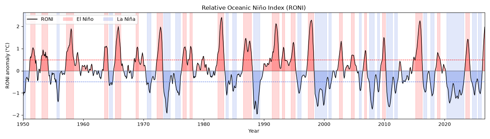

# Vegetation response to atmosphere-ocean circulations <!--{ as="img" mode="hero" src="https://cdn.pixabay.com/photo/2016/11/19/11/11/hands-1838659_1280.jpg" }--> 
## Authors: Theresa Mimi Freiß¹, Thomas Himmer¹ and Fabian Unterasinger¹ <!--{ style="font-size:1.5rem;opacity:0.7;margin-top:1rem;" }-->
> ¹ Vienna University of Technology

*This story is based on results from the Science Hub Challenges organised and hosted by ESA's ESRIN Science Hub in **November 2026**. It was developed by a team from the **Vienna University of Technology**.*

## 

  

## Challenge
Atmosphere-ocean circulations significantly impact our environmental and socioeconomic systems worldwide. The El Niño-Southern Oscillation (ENSO) is one of the most influential climate variations, altering weather patterns across the globe. Year-to-year conditions in the tropical Pacific Ocean fluctuate between unusually warm (El Niño) and cold (La Niña) phases. These fluctuations, typically spanning two to seven years, disrupt atmospheric pressure patterns between the tropical Indian and Pacific Oceans. The resulting shifts in environmental conditions directly influence primary production patterns within the global carbon cycle. This challenge investigates the sensitivity of vegetation to these atmosphere-ocean circulations.

## Objective
This study aims to quantify the impact of ENSO phases (La Niña and El Niño) on vegetation dynamics compared to neutral baseline conditions. 
By analyzing timeseries of climate oscillation indices alongside vegetation specific Earth observation data, we seek to identify the spatio-temporal scales at which vegetation exhibits a response to ENSO-driven forcing.

## Earth observations <!--{ as="eox-map" mode="tour" position="left" }-->

### <!--{ zoom=2.6 center=[-10.5,7.8] layers='[{"type":"Tile","properties":{"id":"terrain-light"},"source":{"type":"WMTSCapabilities","url":"https://tiles.maps.eox.at/wmts/1.0.0/WMTSCapabilities.xml","layer":"terrain-light_3857"}},{"type":"Tile","properties":{"id":"ESDC_nirv"},"source":{"type":"XYZ","url":"https://api.earthsystemdatalab.net/api/tiles/esdc/kndvi/{z}/{y}/{x}?crs=EPSG:3857&time=2021-12-23T00:00:00Z&vmin=0&vmax=1&cbar=RdYlGn"}}]' animationOptions='{"duration":500}' }-->
#### Global scale
The global perspective allows us to broadly observe climate anomalies and their relationship to vegetation growth and health. By utilizing coarse-resolution data, we can identify large-scale trends and regional or temporal differences.

### <!--{ zoom=2.8 center=[-150,0] layers='[{"type":"Tile","properties":{"id":"terrain-light"},"source":{"type":"WMTSCapabilities","url":"https://tiles.maps.eox.at/wmts/1.0.0/WMTSCapabilities.xml","layer":"terrain-light_3857"}},{"type":"Tile","properties":{"id":"ESDC_nirv"},"source":{"type":"XYZ","url":"https://api.earthsystemdatalab.net/api/tiles/esdc/kndvi/{z}/{y}/{x}?crs=EPSG:3857&time=2021-12-23T00:00:00Z&vmin=0&vmax=1&cbar=RdYlGn"}}]' animationOptions='{"duration":500}' }-->
#### ENSO
In the tropical Pacific-Indian Ocean interaction zone, ENSO dynamics drive major shifts in atmospheric pressure and sea surface temperatures. The Relative Oceanic Niño Index (RONI) serves as a key indicator, distinguishing between El Niño (warm) and La Niña (cold) conditions.

<figcaption>***Fig. 1:*** *Relative Oceanic Niño Index (RONI) from 1950 to 2026 indicating warm El Niño (positive, red) and cold La Niña (negative, blue) periods.*</figcaption>

These ENSO-driven variations in climate conditions result in altered weather patterns globally. Seasonal differences reveal whether an El Niño or La Niña period occurs.

<figcaption>***Fig. 2:*** *El Niño effects from December to February.*</figcaption>

<figcaption>***Fig. 3:*** *El Niño effects from June to August.*</figcaption>

<figcaption>***Fig. 4:*** *La Niña effects from December to February.*</figcaption>

<figcaption>***Fig. 5:*** *La Niña effects from June to August.*</figcaption>

### <!--{ zoom=3 center=[10,0] layers='[{"type":"Tile","properties":{"id":"terrain-light"},"source":{"type":"WMTSCapabilities","url":"https://tiles.maps.eox.at/wmts/1.0.0/WMTSCapabilities.xml","layer":"terrain-light_3857"}},{"type":"Tile","properties":{"id":"ESDC_nirv"},"source":{"type":"XYZ","url":"https://api.earthsystemdatalab.net/api/tiles/esdc/kndvi/{z}/{y}/{x}?crs=EPSG:3857&time=2021-12-23T00:00:00Z&vmin=0&vmax=1&cbar=RdYlGn"}}]' animationOptions='{"duration":500}' }-->
#### Anomalies
When analyzing the correlation between ENSO indices and vegetation indices anomalies, we observe distinct spatio-temporal patterns. Vegetation anomalies can coincide with ENSO-driven extreme precipitation shifts, possibly revealing sensitive regional ecosystems that experience (delayed) responses to ocean-atmospheric forcing.

In this study, we investigate the southeastern region of South America and Sub-Saharan Africa in greater detail.

## Data and Methods
#### Dataset
This study utilizes climate and vegetation indices to assess ecosystem sensitivity.

**NOAA Climate Oscillation Indices** (2001–2021, global scale, monthly resolution)
- **Relative Oceanic Niño Index (RONI):** A 3-month running mean of tropical-adjusted Niño 3.4 SST anomalies (1991–2020 base period)

**ESDC Vegetation Indices** (2001–2021, 0.25° and 1° spatial resolution, monthly temporal resolution)
- **Near Infrared Reflectance of Vegetation (NIRv):** Derived from MODIS/Terra+Aqua BRDF/Albedo data
- **Normalized Difference Vegetation Index (NDVI):** MODIS/Terra+Aqua BRDF/Albedo Nadir BRDF-Adjusted Reflectance Daily L3 Global 0.05 Deg CMG and Vegetation Indices
- **Gross Primary Productivity (GPP):** FLUXCOM

#### Methodology
The study is carried out first at a coarse global sclale to identify large-scale spatio-temporal patterns and trends.
Then two major areas are analyzed spacially in more detail: the southeastern region of South America and Sub-Saharan Africa.
Our analytical workflow includes:
1. **Data Retrieval:** Extraction of NOAA RONI indices and DeepESDL ESDC vegetation indices (NIRv, NDVI and GPP).
2. **Preprocessing:** Time-series extraction, spatio-temporal aggregation,  decomposition to remove mean seasonal cycle and linear trend. 
3. **Correlation Analysis:** Evaluation of lag-time correlation responses between ENSO indices and vegetation anomalies. Identification trends and anomalies. Phase-specific (El Niño vs. La Niña) analysis.
4. **Hotspot Identification:** Mapping geographical areas that show statistically significant vegetation response to ENSO. Creation of global maps and time series of southeastern South America and Sub-Saharan-Africa. Production of phase-specific (El Niño vs. La Niña) maps.

## Results
Our findings, derived from comparing NIRv, NDVI, and GPP vegetation indices against RONI, provide insight into vegetation response to ENSO at different scales.
The results comprise global and regional maps of lag-time correlation and regional timeseries, alongside phase-specific analyses that reveal how vegetation indices shift in response to El Niño and La Niña periods.

##### Global study

##### Regional study

##### Phase-specific analysis

## Conclusions

## Open Science
All processing workflows and data analysis scripts are developed within an open-science framework to ensure reproducibility and transparency in our findings regarding vegetation response to ENSO.

| **Name** | **Type** | **Agency / Provider** | **Description / Usage** |
| --- | --- | --- | --- |
| **[RONI](https://www.ncei.noaa.gov/access/monitoring/enso/sst#roni)** | Dataset | NOAA | Climate Oscillation Indices |
| **[ESDC](https://earthsystemdatalab.net/guide/data/pre-generated/ESDC/)** | Dataset | DeepESDL | Vegetation Indices |
| **[DeepESDL](https://earthsystemdatalab.net/)** | Platform  | ESA EarthCODE | ESDC Vegetation Data |

#### Notebook
Access the notebook to reproduce the study workflow.
<iframe width="100%" height="600" src="link-to-notebook" frameborder="0"></iframe>

#### References
- Michael J. McPhaden et al. ,ENSO as an Integrating Concept in Earth Science.Science314,1740-1745(2006). DOI:10.1126/science.1132588
- National Oceanic and Atmospheric Administration (NOAA), Cold & Warm Episodes by Season - Relative Oceanic Niño Index (RONI):
Historical El Niño / La Niña episodes (1950–Present). https://cpc.ncep.noaa.gov/products/analysis_monitoring/enso/roni/
- National Oceanic and Atmospheric Administration (NOAA), Weather Impacts of ENSO. https://www.noaa.gov/jetstream/enso_impacts
- DeepESDL, Earth System Data Cube (ESDC) v3.0.1. https://earthsystemdatalab.net/guide/data/pre-generated/ESDC/

## Contributors
Theresa Mimi Freiß, Thomas Himmer, and Fabian Unterasinger. 
