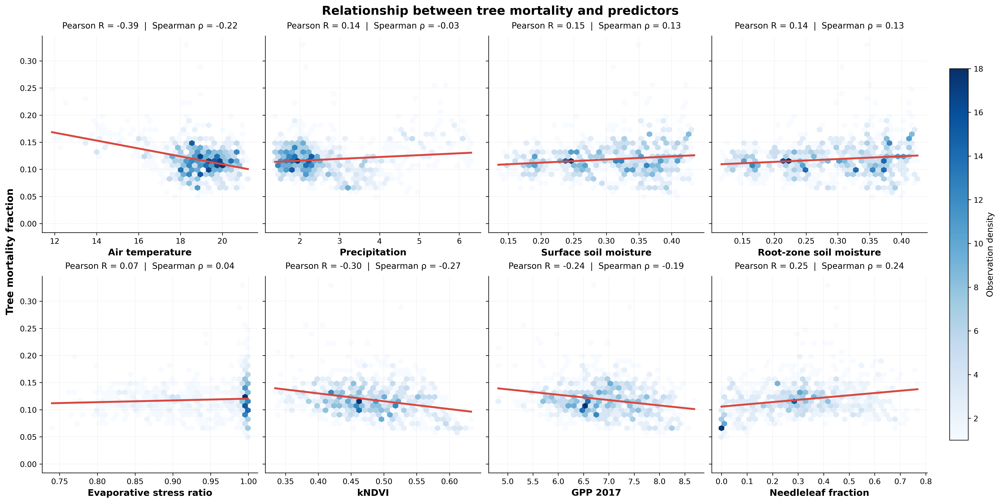
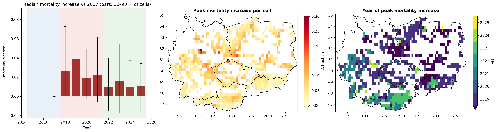
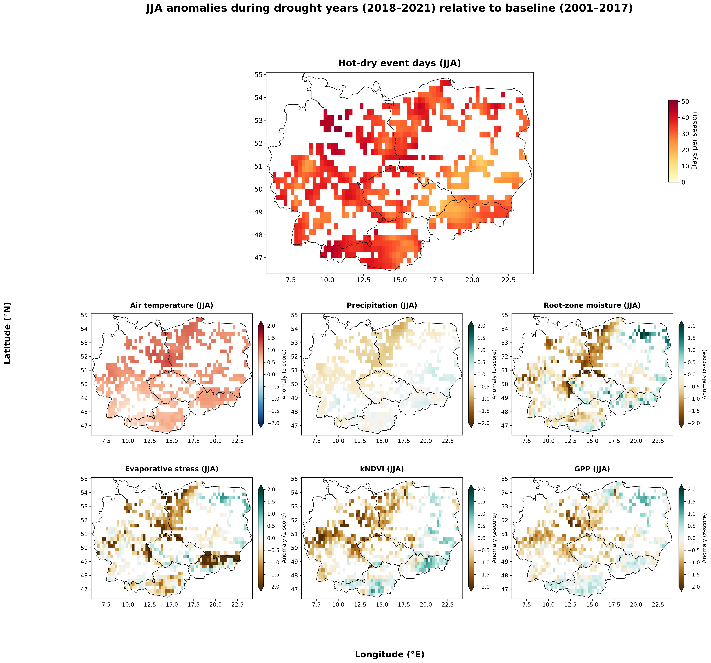
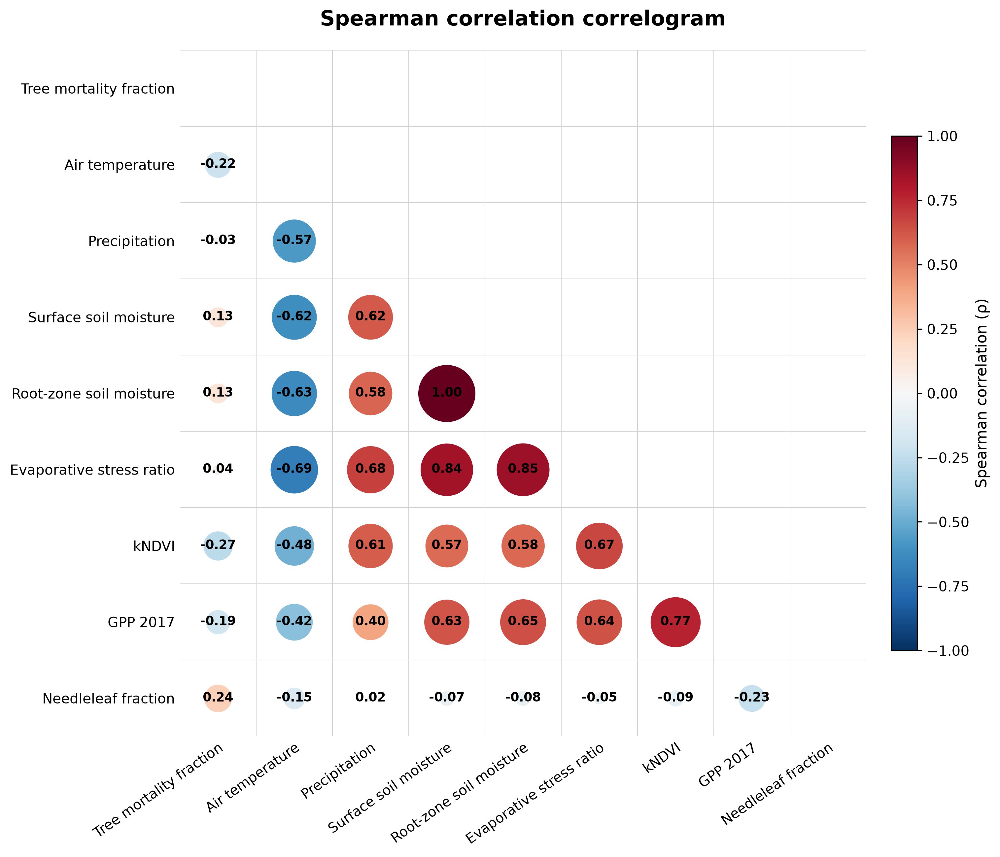
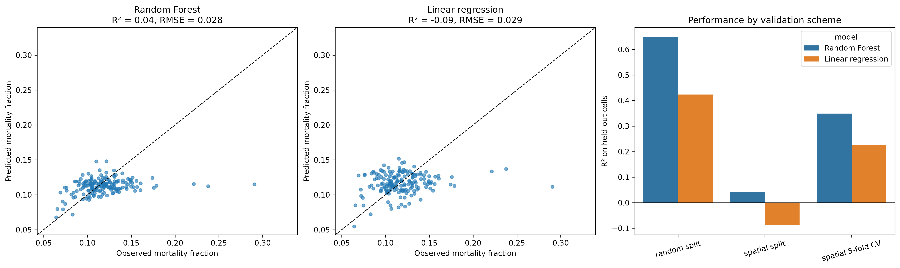
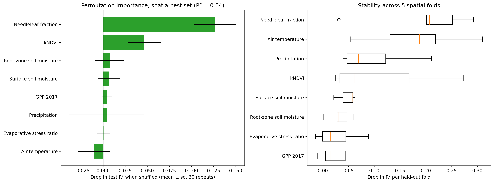

# Drivers of tree mortality <!--{ as="img" mode="hero" src="https://encrypted-tbn0.gstatic.com/images?q=tbn:ANd9GcSoQjsfbD7h_AsxjQTRhWyIqKCHuItJhqu-SjN7Rq2NZ492SPlzK3cRgls&s=10" }-->
#### 

## Authors:
> ¹ Anna Bartels ² Daria Ilina  ³ Elias Gmeiner

*This story is based on results from the Science Hub Challenges organised and hosted by ESA's ESRIN Science Hub in November 2026. It was developed by a team from the TU Vienna and Ruhr Universtiy Bochum.

## 

  

  
  

## Challenge
Climate change is reshaping the vegetation structure and dynamics. These transformations are already measurable across the globe (IPCC 2013; Neumann et al. 2017). For the upcoming time, further significant changes are expected regarding the range and distribution of species.

In Central Europe, forests have already experienced an increase in the frequency and intensity of tree mortality. These effects are primarily driven by recurring extreme droughts and compounding biotic stressors, which exceed the adaptive capacities of long-lived species (Seidl et al. 2017).

The increasing mortality rate threatens the resilience of forests in Europe and challenges the sustainable provision of essential ecosystem services to society (Neumann et al. 2017).

Additionally, tree mortality is a crucial factor as it can trigger irreversible changes in forest communities by pushing ecosystems past critical ecological thresholds (Scheffer et al. 2012). Addressing this vulnerability requires a large-scale understanding of the climatic factors causing tree mortality to identify potential changes before critical tipping points are reached.

## Objective

  

    Tree mortality has risen sharply in many regions in recent years.
    But which environmental factors best explain where trees are dying?
  

  

    In this study, we investigate this question for Central Europe, covering Germany,
    Austria, Czechia, Slovakia and Poland. Using a gridded data cube, we relate the
    observed fraction of tree mortality in each forest cell to a set of environmental
    predictors.
  

  

## Data and Methods
#### Dataset

<table style="border-collapse: collapse; width: 100%;">
  <thead>
    <tr>
      <th style="text-align:center; border:1px solid #ccc; padding:6px;">Datacube name</th>
      <th style="text-align:center; border:1px solid #ccc; padding:6px;">Variable name</th>
      <th style="text-align:center; border:1px solid #ccc; padding:6px;">Time range</th>
      <th style="text-align:center; border:1px solid #ccc; padding:6px;">Resolution</th>
    </tr>
  </thead>
  <tbody>
    <tr>
      <td style="text-align:center; border:1px solid #ccc; padding:6px;">deadtrees.earth v5</td>
      <td style="text-align:center; border:1px solid #ccc; padding:6px;">tree_mortality_fraction</td>
      <td style="text-align:center; border:1px solid #ccc; padding:6px;">2019–2022</td>
      <td style="text-align:center; border:1px solid #ccc; padding:6px;">10 m (input); 0.25° (output), EPSG:3035 input, pyramid level 7 (1.28 km)</td>
    </tr>
    <tr>
      <td style="text-align:center; border:1px solid #ccc; padding:6px;">ESDC</td>
      <td style="text-align:center; border:1px solid #ccc; padding:6px;">air_temperature</td>
      <td style="text-align:center; border:1px solid #ccc; padding:6px;">2018–2021</td>
      <td style="text-align:center; border:1px solid #ccc; padding:6px;">0.25°, 8-day</td>
    </tr>
    <tr>
      <td style="text-align:center; border:1px solid #ccc; padding:6px;">ESDC</td>
      <td style="text-align:center; border:1px solid #ccc; padding:6px;">surface_moisture</td>
      <td style="text-align:center; border:1px solid #ccc; padding:6px;">2018–2021</td>
      <td style="text-align:center; border:1px solid #ccc; padding:6px;">0.25°, 8-day</td>
    </tr>
    <tr>
      <td style="text-align:center; border:1px solid #ccc; padding:6px;">ESDC</td>
      <td style="text-align:center; border:1px solid #ccc; padding:6px;">root_zone_moisture</td>
      <td style="text-align:center; border:1px solid #ccc; padding:6px;">2018–2021</td>
      <td style="text-align:center; border:1px solid #ccc; padding:6px;">0.25°, 8-day</td>
    </tr>
    <tr>
      <td style="text-align:center; border:1px solid #ccc; padding:6px;">ESDC</td>
      <td style="text-align:center; border:1px solid #ccc; padding:6px;">evaporative_stress</td>
      <td style="text-align:center; border:1px solid #ccc; padding:6px;">2018–2021</td>
      <td style="text-align:center; border:1px solid #ccc; padding:6px;">0.25°, 8-day</td>
    </tr>
    <tr>
      <td style="text-align:center; border:1px solid #ccc; padding:6px;">ESDC</td>
      <td style="text-align:center; border:1px solid #ccc; padding:6px;">kNDVI</td>
      <td style="text-align:center; border:1px solid #ccc; padding:6px;">2018–2021</td>
      <td style="text-align:center; border:1px solid #ccc; padding:6px;">0.25°, 8-day</td>
    </tr>
    <tr>
      <td style="text-align:center; border:1px solid #ccc; padding:6px;">ESDC</td>
      <td style="text-align:center; border:1px solid #ccc; padding:6px;">gpp_2017</td>
      <td style="text-align:center; border:1px solid #ccc; padding:6px;">2017</td>
      <td style="text-align:center; border:1px solid #ccc; padding:6px;">0.25°, 8-day</td>
    </tr>
    <tr>
      <td style="text-align:center; border:1px solid #ccc; padding:6px;">ESA CCI Land Cover 2018</td>
      <td style="text-align:center; border:1px solid #ccc; padding:6px;">forest_fraction</td>
      <td style="text-align:center; border:1px solid #ccc; padding:6px;">2018</td>
      <td style="text-align:center; border:1px solid #ccc; padding:6px;">300 m (input); 0.25° (output)</td>
    </tr>
    <tr>
      <td style="text-align:center; border:1px solid #ccc; padding:6px;">ESA CCI Land Cover 2018</td>
      <td style="text-align:center; border:1px solid #ccc; padding:6px;">needleleaf_fraction</td>
      <td style="text-align:center; border:1px solid #ccc; padding:6px;">2018</td>
      <td style="text-align:center; border:1px solid #ccc; padding:6px;">300 m (input); 0.25° (output)</td>
    </tr>
    <tr>
      <td style="text-align:center; border:1px solid #ccc; padding:6px;">Dheed v4</td>
      <td style="text-align:center; border:1px solid #ccc; padding:6px;">EventCube</td>
      <td style="text-align:center; border:1px solid #ccc; padding:6px;">1950–2023</td>
      <td style="text-align:center; border:1px solid #ccc; padding:6px;">0.25°, daily</td>
    </tr>
  </tbody>
</table>

#### Methodology workflow

  <h5>Study area and period</h5>
  

    Germany, Czechia, Austria, Poland and Slovakia, analyzed on the 0.25° grid of the
    Earth System Data Cube (ESDC). Only forest cells are used (forest fraction ≥ 0.3 from
    ESA CCI land cover 2018). The drought period is 2018–2021 and the reference period
    is 2001–2017.
  

  <h5>Mortality</h5>
  

    Tree mortality fraction = standing deadwood cover / tree cover (deadtrees.earth v5,
    10 m), area-averaged to the 0.25° cells.
  

  <h5>Predictors</h5>
  <ul>
    <li>
      <strong>ESDC (8-day):</strong> air temperature, precipitation, surface and root-zone
      soil moisture, evaporative stress, kNDVI and GPP.
    </li>
    <li><strong>Land cover:</strong> needleleaf fraction.</li>
    <li><strong>DHEED:</strong> compound hot-dry event days.</li>
  </ul>

  <h5>Two complementary analyses</h5>
  <ol>
    <li>
      <strong>Overview (no time dimension).</strong> One row per forest cell. Mortality is
      the mean of 2019–2022, and the predictors are June–August means for 2018–2021
      (GPP: 2017). Spearman correlations show the relationships. A Random Forest is
      compared with multiple linear regression on a spatial split (2° blocks, 25% test,
      plus 5-fold block cross-validation). Permutation importance is computed for single
      predictors and for predictor groups.
    </li>
    <li>
      <strong>Seasonal variability (with time dimension).</strong> Monthly means are
      converted to standardized anomalies (z-scores) per cell and calendar month relative
      to 2001–2017, then averaged over June–August. This removes the spatial climate
      gradient, so the maps show how values deviate from normal. Mortality is expressed
      as the increase relative to 2017, which identifies when and where it peaks.
    </li>
  </ol>
</section>

## Results

## Tree mortality <!--{ as="eox-map" mode="tour" position="left" }-->

### <!--{ layers='[{"type":"Tile","properties":{"id":"cloudless-2024;:;EPSG:3857","title":"EOxCloudless 2024"},"source":{"type":"XYZ","url":"//s2maps-tiles.eu/wmts/1.0.0/s2cloudless-2024_3857/default/g/{z}/{y}/{x}.jpeg","projection":"EPSG:3857"}},{"type":"Vector","properties":{"id":"mortality_cells","title":"Tree mortality fraction"},"source":{"type":"Vector","url":"https://raw.githubusercontent.com/egmeiner/eodashboard-narratives/egmeiner/tree-mortality/assets/egmeiner/treemortalitycells-1795012656467.geojson","format":"GeoJSON"},"style":{"fill-color":["interpolate",["linear"],["get","mortality"],0.05,"rgba(35,139,69,0.75)",0.1,"rgba(173,203,80,0.75)",0.15,"rgba(196,150,70,0.75)",0.2,"rgba(120,72,30,0.75)"],"stroke-width":0}},{"type":"Vector","properties":{"id":"country-borders","title":"Country borders"},"source":{"type":"Vector","url":"https://raw.githubusercontent.com/nvkelso/natural-earth-vector/master/geojson/ne_50m_admin_0_countries.geojson","format":"GeoJSON"},"style":{"stroke-color":"#111111","stroke-width":1.5,"fill-color":"rgba(0,0,0,0)"}},{"type":"Tile","properties":{"id":"overlay_bright;:;EPSG:3857","title":"Overlay labels"},"source":{"type":"XYZ","url":"//s2maps-tiles.eu/wmts/1.0.0/overlay_base_bright_3857/default/g/{z}/{y}/{x}.png","projection":"EPSG:3857"}}]' zoom=5.5 center=[10.4,51.1] projection="" animationOptions='{"duration":1500}' }-->
#### Tree Mortality

### <!--{ layers='[{"type":"Tile","properties":{"id":"cloudless-2024;:;EPSG:3857","title":"EOxCloudless 2024"},"source":{"type":"XYZ","url":"//s2maps-tiles.eu/wmts/1.0.0/s2cloudless-2024_3857/default/g/{z}/{y}/{x}.jpeg","projection":"EPSG:3857"}},{"type":"Vector","properties":{"id":"needleleaf_frac","title":"Tree mortality fraction"},"source":{"type":"Vector","url":"https://raw.githubusercontent.com/egmeiner/eodashboard-narratives/egmeiner/tree-mortality/assets/egmeiner/treemortalitycells-1795012656467.geojson","format":"GeoJSON"},"style":{"fill-color":["interpolate",["linear"],["get","needleleaf_frac"],0,"rgba(255,255,255,0.75)",0.2,"rgba(199,233,192,0.75)",0.4,"rgba(116,196,118,0.75)",0.7,"rgba(0,109,44,0.75)"],"stroke-width":0}},{"type":"Vector","properties":{"id":"country-borders","title":"Country borders"},"source":{"type":"Vector","url":"https://raw.githubusercontent.com/nvkelso/natural-earth-vector/master/geojson/ne_50m_admin_0_countries.geojson","format":"GeoJSON"},"style":{"stroke-color":"#111111","stroke-width":1.5,"fill-color":"rgba(0,0,0,0)"}},{"type":"Tile","properties":{"id":"overlay_bright;:;EPSG:3857","title":"Overlay labels"},"source":{"type":"XYZ","url":"//s2maps-tiles.eu/wmts/1.0.0/overlay_base_bright_3857/default/g/{z}/{y}/{x}.png","projection":"EPSG:3857"}}]' zoom=5.5 center=[10.4,51.1] projection="" animationOptions='{"duration":1500}' }-->
#### Needleleaf Fraction

### <!--{ layers='[{"type":"Tile","properties":{"id":"cloudless-2024;:;EPSG:3857","title":"EOxCloudless 2024"},"source":{"type":"XYZ","url":"//s2maps-tiles.eu/wmts/1.0.0/s2cloudless-2024_3857/default/g/{z}/{y}/{x}.jpeg","projection":"EPSG:3857"}},{"type":"Vector","properties":{"id":"kndvi","title":"Tree mortality fraction"},"source":{"type":"Vector","url":"https://raw.githubusercontent.com/egmeiner/eodashboard-narratives/egmeiner/tree-mortality/assets/egmeiner/treemortalitycells-1795012656467.geojson","format":"GeoJSON"},"style":{"fill-color":["interpolate",["linear"],["get","kndvi"],0.35,"rgba(255,255,255,0.75)",0.43,"rgba(199,233,192,0.75)",0.52,"rgba(116,196,118,0.75)",0.6,"rgba(0,109,44,0.75)"],"stroke-width":0}},{"type":"Vector","properties":{"id":"country-borders","title":"Country borders"},"source":{"type":"Vector","url":"https://raw.githubusercontent.com/nvkelso/natural-earth-vector/master/geojson/ne_50m_admin_0_countries.geojson","format":"GeoJSON"},"style":{"stroke-color":"#111111","stroke-width":1.5,"fill-color":"rgba(0,0,0,0)"}},{"type":"Tile","properties":{"id":"overlay_bright;:;EPSG:3857","title":"Overlay labels"},"source":{"type":"XYZ","url":"//s2maps-tiles.eu/wmts/1.0.0/overlay_base_bright_3857/default/g/{z}/{y}/{x}.png","projection":"EPSG:3857"}}]' zoom=5.5 center=[10.4,51.1] projection="" animationOptions='{"duration":1500}' }-->
#### kNDVI

## Results
Note: Figures 1-2 use the seasonal (time) analysis, and Figures 3-7 use the overview dataset. Mortality in Figure 1 is the increase vs 2017, and in Figures 3-7 it is the 2019-2022 mean level. 

Figure 1: Mortality: when and where?
Figure shows the median mortality increase vs 2017 per year (bars: 10-90% of cells), the peak increase per cell, and the year of the peak.
Mortality rises during drought years and peaks in 2019, although some cells show delayed response. Hotspots are concentrated in Central Germany (Thuringia), and in the area around Germany-Poland-Czechia border.

Fig 2: Summer anomalies during the drought 
Figure shows mean June-August anomaly in 2018-2021 relative to 2001-2017 (z-scores; brown = below normal, red = warmer than normal), plus the number of hot-dry event days.
The drought years were warmer and drier than normal, most strongly in regions already mentioned above - Central Germany and Germany-Poland-Czechia intersection. Vegetation (kNDVI, GPP) was lower where soil moisture was low. Generally, anomalies align with the hotspot regions in Fig 1.

Fig 3: Mortality vs each predictor 
Figure shows each predictor against mortality, one cell per dot density (hexbin), with Spearman rho in the titles.
Most relationships are weak to moderate, and mostly non-linear. Air temperature has strong negative correlation with mortality (rho= -0.39), followed by kNDVI (rho = -0.30). and GPP (rho = -0.24). The strongest positive correlation is needleaf fraction (rho= 0.25). However, no single factor explains mortality on itself yet.

Fig 4: Spearman correlation matrix
Figure shows correlations among predictors and with mortality.
Root and surface soil moisture are strongly correlated, so they carry overlapping information. Same goes for GPP and kNDVI. Both SM predictors correlate highly with evaporative stress. GPP is also correlated with precipitation, soil moisture content and evaporation predictors. Air temperature is correlated negatively with all predictors.

Fig 5: Random Forest vs linear regression 
Figure shows predicted vs observed mortality, and R² for:
- random split: test cells are picked randomly, so almost every test cell has neighbors in the training data.
- spatial split: whole 2° blocks (~200 km) are held out for testing. The model must predict regions it has never seen. This is the honest exam, but it uses a single test region, so the score depends on which region happened to be chosen (noisy, and can be negative.
- spatial 5-fold CV: the map is divided into 5 groups of blocks; 5ive times, one group is the test region and the other four train the model. The five scores are averaged. Every cell is tested exactly once as part of a region the model has not seen. This is the most reliable number.
The Random Forest reaches R² = 0.04 (spatial CV) vs -0.09 for linear regression, so, essentially, neither model predicts mortality in new regions in any useful way. RF explains about 4% of the variation, which is practically nothing. Linear regression is slightly worse than the average guess. With spatial validation, neither model predicts mortality in unseen regions, so the predictors do not explain regional differences in mortality at this resolution.
A random split would suggest the model works. Testing on unseen regions shows that it does not. 
Possible explanation: this model was trained only on spatial spit. The ESDC variables start and end in different years, and have limited common temporal coverage, so spatial split seemed like a reasonable solution. Attempt to train model with averaged predictors per year failed (R = -0.82).

Fig 6: Permutation importance and stability across spatial folds
Figure shows  the drop in test R² when one predictor is shuffled (left), and the spread of that drop across five spatial folds (right). So the left plot is one test region and the right plot asks whether the result holds in other regions.
Interpretation: Needleleef fraction has a relatively narrow box clearly above 0, meaning this predictor mattered in most regions. Air temperature and kNDVI have wide boxes, meaning they only mattered in some regions.

## Conclusion
Mortality peaked 1 years after the 2018 drought onset. Needleaf fraction was most associated with it. There is a good explanation for that. In the last century, the area investigated in this study was planted with monoculture of spruce trees, mostly due to their fast growth and amount of wood produced. Lack of biodiversity combined with environmental stress of last years weakened the trees and made them vulnerable for bark-beetle. 
Limits: the maps do not separate drought, bark beetle, storm, and harvest. The 25 km grid averages out local conditions. Correlation and importance do not prove causation. 

## Open Science <!--{ as="div" component="div" }-->

## Contributors
Authors, contibutors, reviewers
