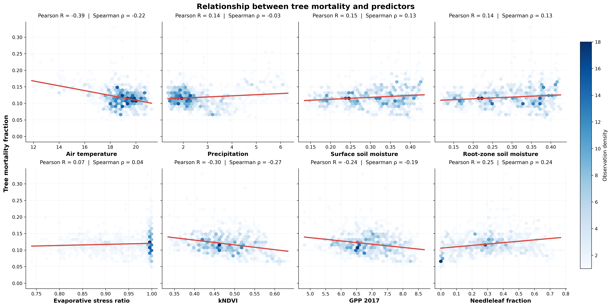
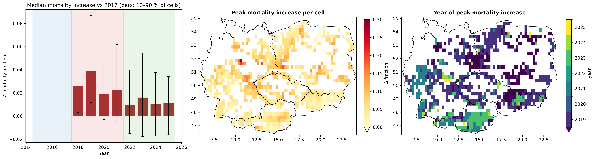
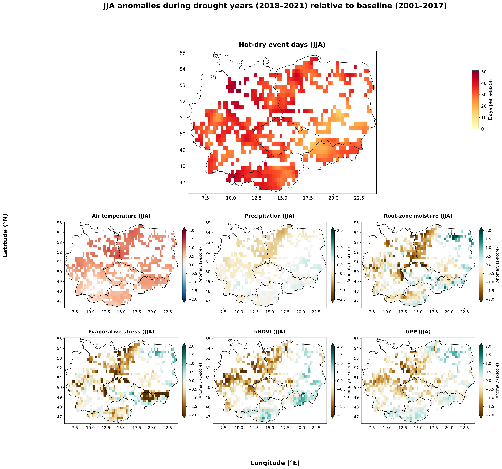
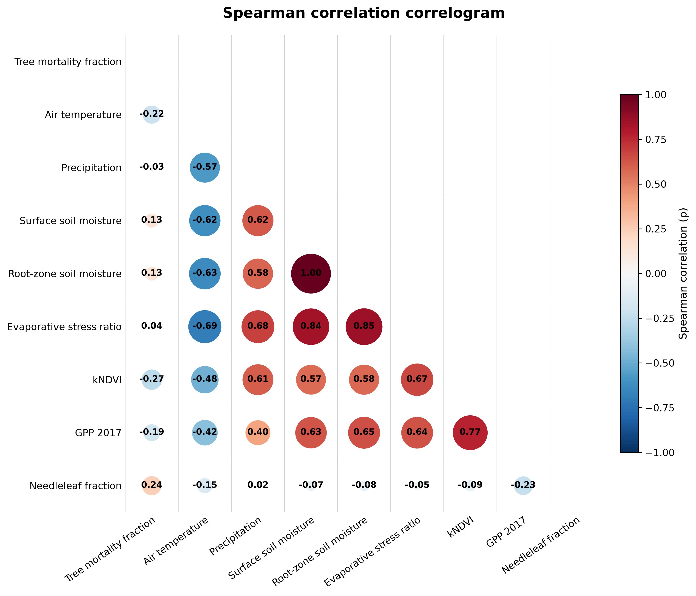
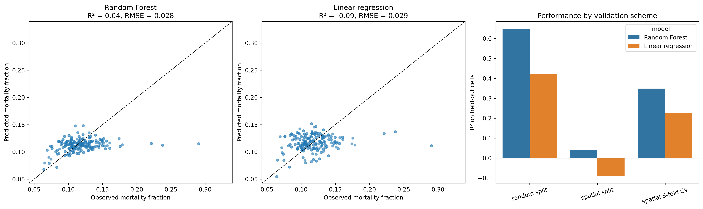
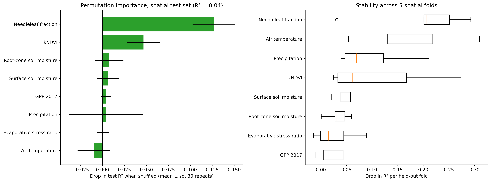
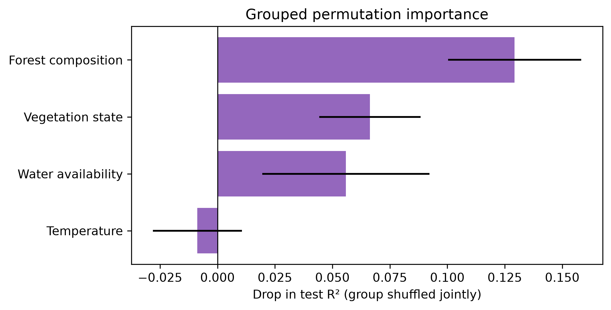

# Drivers of tree mortality <!--{ as="img" mode="hero" src="https://encrypted-tbn0.gstatic.com/images?q=tbn:ANd9GcSoQjsfbD7h_AsxjQTRhWyIqKCHuItJhqu-SjN7Rq2NZ492SPlzK3cRgls&s=10" }-->
#### 

## Authors:
> ¹ Anna Bartels ² Daria Ilina  ³ Elias Gmeiner

*This story is based on results from the Science Hub Challenges organised and hosted by ESA's ESRIN Science Hub in November 2026. It was developed by a team from the TU Vienna and Ruhr Universtiy Bochum.

## 

  

  
  

## Challenge
Climate change is reshaping the vegetation structure and dynamics. These transformations are already measurable across the globe (IPCC 2013; Neumann et al. 2017). For the upcoming time, further significant changes are expected regarding the range and distribution of species.

In Central Europe, forests have already experienced an increase in the frequency and intensity of tree mortality. These effects are primarily driven by recurring extreme droughts and compounding biotic stressors, which exceed the adaptive capacities of long-lived species (Seidl et al. 2017).

The increasing mortality rate threatens the resilience of forests in Europe and challenges the sustainable provision of essential ecosystem services to society (Neumann et al. 2017).

Additionally, tree mortality is a crucial factor as it can trigger irreversible changes in forest communities by pushing ecosystems past critical ecological thresholds (Scheffer et al. 2012). Addressing this vulnerability requires a large-scale understanding of the climatic factors causing tree mortality to identify potential changes before critical tipping points are reached.

## Objective

  

    Tree mortality has risen sharply in many regions in recent years.
    But which environmental factors best explain where trees are dying?
  

  

    In this study, we investigate this question for Central Europe, covering Germany,
    Austria, Czechia, Slovakia and Poland. Using a gridded data cube, we relate the
    observed fraction of tree mortality in each forest cell to a set of environmental
    predictors.
  

  

## Data and Methods
#### Dataset

<table style="border-collapse: collapse; width: 100%;">
  <thead>
    <tr>
      <th style="text-align:center; border:1px solid #ccc; padding:6px;">Datacube name</th>
      <th style="text-align:center; border:1px solid #ccc; padding:6px;">Variable name</th>
      <th style="text-align:center; border:1px solid #ccc; padding:6px;">Time range</th>
      <th style="text-align:center; border:1px solid #ccc; padding:6px;">Resolution</th>
    </tr>
  </thead>
  <tbody>
    <tr>
      <td style="text-align:center; border:1px solid #ccc; padding:6px;">deadtrees.earth v5</td>
      <td style="text-align:center; border:1px solid #ccc; padding:6px;">tree_mortality_fraction</td>
      <td style="text-align:center; border:1px solid #ccc; padding:6px;">2019–2022</td>
      <td style="text-align:center; border:1px solid #ccc; padding:6px;">10 m (input); 0.25° (output), EPSG:3035 input, pyramid level 7 (1.28 km)</td>
    </tr>
    <tr>
      <td style="text-align:center; border:1px solid #ccc; padding:6px;">ESDC</td>
      <td style="text-align:center; border:1px solid #ccc; padding:6px;">air_temperature</td>
      <td style="text-align:center; border:1px solid #ccc; padding:6px;">2018–2021</td>
      <td style="text-align:center; border:1px solid #ccc; padding:6px;">0.25°, 8-day</td>
    </tr>
    <tr>
      <td style="text-align:center; border:1px solid #ccc; padding:6px;">ESDC</td>
      <td style="text-align:center; border:1px solid #ccc; padding:6px;">surface_moisture</td>
      <td style="text-align:center; border:1px solid #ccc; padding:6px;">2018–2021</td>
      <td style="text-align:center; border:1px solid #ccc; padding:6px;">0.25°, 8-day</td>
    </tr>
    <tr>
      <td style="text-align:center; border:1px solid #ccc; padding:6px;">ESDC</td>
      <td style="text-align:center; border:1px solid #ccc; padding:6px;">root_zone_moisture</td>
      <td style="text-align:center; border:1px solid #ccc; padding:6px;">2018–2021</td>
      <td style="text-align:center; border:1px solid #ccc; padding:6px;">0.25°, 8-day</td>
    </tr>
    <tr>
      <td style="text-align:center; border:1px solid #ccc; padding:6px;">ESDC</td>
      <td style="text-align:center; border:1px solid #ccc; padding:6px;">evaporative_stress</td>
      <td style="text-align:center; border:1px solid #ccc; padding:6px;">2018–2021</td>
      <td style="text-align:center; border:1px solid #ccc; padding:6px;">0.25°, 8-day</td>
    </tr>
    <tr>
      <td style="text-align:center; border:1px solid #ccc; padding:6px;">ESDC</td>
      <td style="text-align:center; border:1px solid #ccc; padding:6px;">kNDVI</td>
      <td style="text-align:center; border:1px solid #ccc; padding:6px;">2018–2021</td>
      <td style="text-align:center; border:1px solid #ccc; padding:6px;">0.25°, 8-day</td>
    </tr>
    <tr>
      <td style="text-align:center; border:1px solid #ccc; padding:6px;">ESDC</td>
      <td style="text-align:center; border:1px solid #ccc; padding:6px;">gpp_2017</td>
      <td style="text-align:center; border:1px solid #ccc; padding:6px;">2017</td>
      <td style="text-align:center; border:1px solid #ccc; padding:6px;">0.25°, 8-day</td>
    </tr>
    <tr>
      <td style="text-align:center; border:1px solid #ccc; padding:6px;">ESA CCI Land Cover 2018</td>
      <td style="text-align:center; border:1px solid #ccc; padding:6px;">forest_fraction</td>
      <td style="text-align:center; border:1px solid #ccc; padding:6px;">2018</td>
      <td style="text-align:center; border:1px solid #ccc; padding:6px;">300 m (input); 0.25° (output)</td>
    </tr>
    <tr>
      <td style="text-align:center; border:1px solid #ccc; padding:6px;">ESA CCI Land Cover 2018</td>
      <td style="text-align:center; border:1px solid #ccc; padding:6px;">needleleaf_fraction</td>
      <td style="text-align:center; border:1px solid #ccc; padding:6px;">2018</td>
      <td style="text-align:center; border:1px solid #ccc; padding:6px;">300 m (input); 0.25° (output)</td>
    </tr>
    <tr>
      <td style="text-align:center; border:1px solid #ccc; padding:6px;">Dheed v4</td>
      <td style="text-align:center; border:1px solid #ccc; padding:6px;">EventCube</td>
      <td style="text-align:center; border:1px solid #ccc; padding:6px;">1950–2023</td>
      <td style="text-align:center; border:1px solid #ccc; padding:6px;">0.25°, daily</td>
    </tr>
  </tbody>
</table>

#### Methodology workflow
Description

## Results

## Tree mortality <!--{ as="eox-map" mode="tour" position="left" }-->

### <!--{ layers='[{"type":"Tile","properties":{"id":"cloudless-2024;:;EPSG:3857","title":"EOxCloudless 2024"},"source":{"type":"XYZ","url":"//s2maps-tiles.eu/wmts/1.0.0/s2cloudless-2024_3857/default/g/{z}/{y}/{x}.jpeg","projection":"EPSG:3857"}},{"type":"Vector","properties":{"id":"mortality_cells","title":"Tree mortality fraction"},"source":{"type":"Vector","url":"https://raw.githubusercontent.com/egmeiner/eodashboard-narratives/egmeiner/tree-mortality/assets/egmeiner/treemortalitycells-1795012656467.geojson","format":"GeoJSON"},"style":{"fill-color":["interpolate",["linear"],["get","mortality"],0.05,"rgba(35,139,69,0.75)",0.1,"rgba(173,203,80,0.75)",0.15,"rgba(196,150,70,0.75)",0.2,"rgba(120,72,30,0.75)"],"stroke-width":0}},{"type":"Vector","properties":{"id":"country-borders","title":"Country borders"},"source":{"type":"Vector","url":"https://raw.githubusercontent.com/nvkelso/natural-earth-vector/master/geojson/ne_50m_admin_0_countries.geojson","format":"GeoJSON"},"style":{"stroke-color":"#111111","stroke-width":1.5,"fill-color":"rgba(0,0,0,0)"}},{"type":"Tile","properties":{"id":"overlay_bright;:;EPSG:3857","title":"Overlay labels"},"source":{"type":"XYZ","url":"//s2maps-tiles.eu/wmts/1.0.0/overlay_base_bright_3857/default/g/{z}/{y}/{x}.png","projection":"EPSG:3857"}}]' zoom=5.5 center=[10.4,51.1] projection="" animationOptions='{"duration":1500}' }-->
#### Tree Mortality

### <!--{ layers='[{"type":"Tile","properties":{"id":"cloudless-2024;:;EPSG:3857","title":"EOxCloudless 2024"},"source":{"type":"XYZ","url":"//s2maps-tiles.eu/wmts/1.0.0/s2cloudless-2024_3857/default/g/{z}/{y}/{x}.jpeg","projection":"EPSG:3857"}},{"type":"Vector","properties":{"id":"needleleaf_frac","title":"Tree mortality fraction"},"source":{"type":"Vector","url":"https://raw.githubusercontent.com/egmeiner/eodashboard-narratives/egmeiner/tree-mortality/assets/egmeiner/treemortalitycells-1795012656467.geojson","format":"GeoJSON"},"style":{"fill-color":["interpolate",["linear"],["get","needleleaf_frac"],0,"rgba(255,255,255,0.75)",0.2,"rgba(199,233,192,0.75)",0.4,"rgba(116,196,118,0.75)",0.7,"rgba(0,109,44,0.75)"],"stroke-width":0}},{"type":"Vector","properties":{"id":"country-borders","title":"Country borders"},"source":{"type":"Vector","url":"https://raw.githubusercontent.com/nvkelso/natural-earth-vector/master/geojson/ne_50m_admin_0_countries.geojson","format":"GeoJSON"},"style":{"stroke-color":"#111111","stroke-width":1.5,"fill-color":"rgba(0,0,0,0)"}},{"type":"Tile","properties":{"id":"overlay_bright;:;EPSG:3857","title":"Overlay labels"},"source":{"type":"XYZ","url":"//s2maps-tiles.eu/wmts/1.0.0/overlay_base_bright_3857/default/g/{z}/{y}/{x}.png","projection":"EPSG:3857"}}]' zoom=5.5 center=[10.4,51.1] projection="" animationOptions='{"duration":1500}' }-->
#### Needleleaf Fraction

### <!--{ layers='[{"type":"Tile","properties":{"id":"cloudless-2024;:;EPSG:3857","title":"EOxCloudless 2024"},"source":{"type":"XYZ","url":"//s2maps-tiles.eu/wmts/1.0.0/s2cloudless-2024_3857/default/g/{z}/{y}/{x}.jpeg","projection":"EPSG:3857"}},{"type":"Vector","properties":{"id":"kndvi","title":"Tree mortality fraction"},"source":{"type":"Vector","url":"https://raw.githubusercontent.com/egmeiner/eodashboard-narratives/egmeiner/tree-mortality/assets/egmeiner/treemortalitycells-1795012656467.geojson","format":"GeoJSON"},"style":{"fill-color":["interpolate",["linear"],["get","kndvi"],0.35,"rgba(255,255,255,0.75)",0.43,"rgba(199,233,192,0.75)",0.52,"rgba(116,196,118,0.75)",0.6,"rgba(0,109,44,0.75)"],"stroke-width":0}},{"type":"Vector","properties":{"id":"country-borders","title":"Country borders"},"source":{"type":"Vector","url":"https://raw.githubusercontent.com/nvkelso/natural-earth-vector/master/geojson/ne_50m_admin_0_countries.geojson","format":"GeoJSON"},"style":{"stroke-color":"#111111","stroke-width":1.5,"fill-color":"rgba(0,0,0,0)"}},{"type":"Tile","properties":{"id":"overlay_bright;:;EPSG:3857","title":"Overlay labels"},"source":{"type":"XYZ","url":"//s2maps-tiles.eu/wmts/1.0.0/overlay_base_bright_3857/default/g/{z}/{y}/{x}.png","projection":"EPSG:3857"}}]' zoom=5.5 center=[10.4,51.1] projection="" animationOptions='{"duration":1500}' }-->
#### kNDVI

## Conclusions

Mortality vs each predictor (hexbin) Each panel is one predictor (x) against mortality (y), one dot per cell. Hexagons show how many cells fall in each region, which avoids overplotting. Spearman rho (in the title) measures how consistently mortality rises or falls with the predictor, based on ranks. It is robust to outliers and does not assume a straight line. Reasoning: shows the shape of each relationship (linear, threshold, none), which is why a non-linear model like Random Forest is worth trying.

Shows the correlation between all variable pairs. First row/column: the individual relationship of each predictor with mortality. Rest of the matrix: correlations between predictors (collinearity). Pairs with |rho| > 0.8 (printed below the plot) carry overlapping information, so permutation importance in the Random Forest will split or understate them.

Shows: predictions against observations on held-out cells for Random Forest and linear regression, and R² for three validation schemes. Analysis: both models were trained on the same split. Random split, spatial split, and spatial 5-fold CV were compared. RMSE was compared against a mean-prediction baseline. Reading: RF reaches R² = [x] (spatial CV) vs [y] for linear regression, so non-linear effects [do / do not] add substantial skill. The gap between random and spatial R² ([x] vs [y]) shows how much spatial leakage inflates the score.

## Open Science <!--{ as="div" component="div" }-->

## Contributors
Authors, contibutors, reviewers
